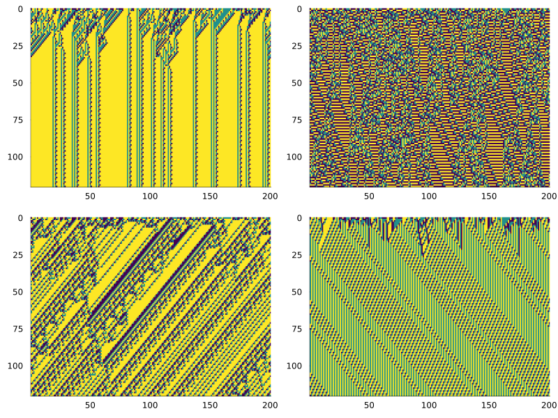
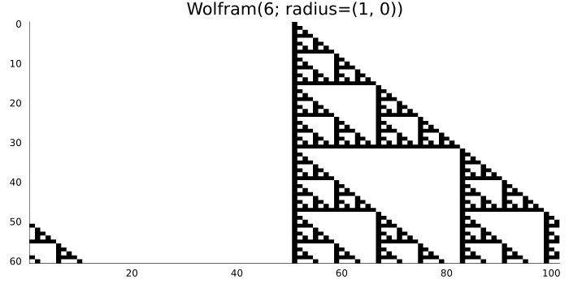
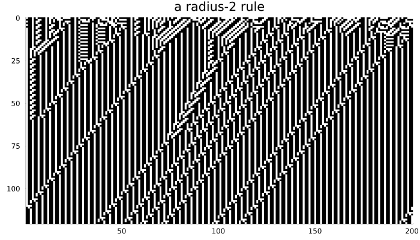
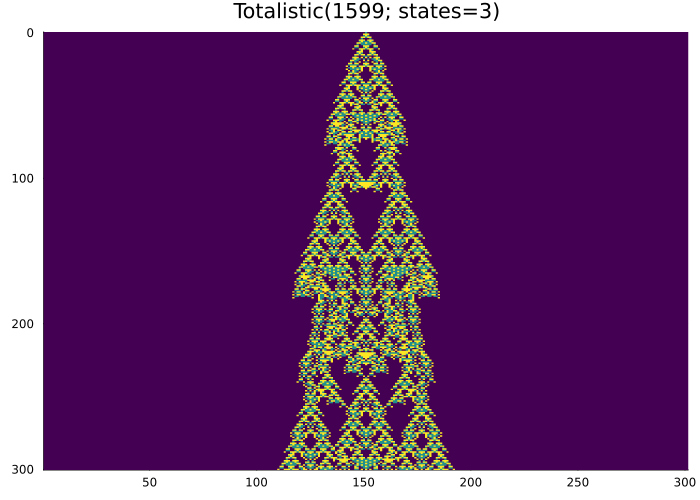
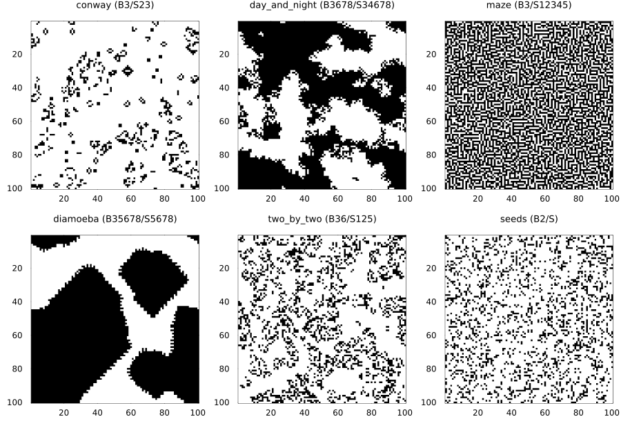
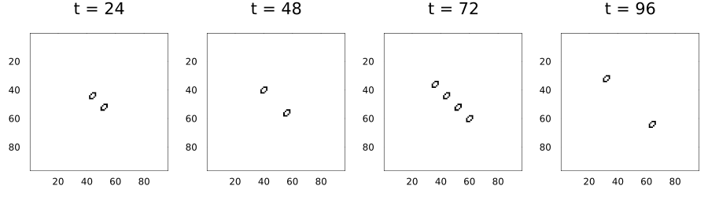
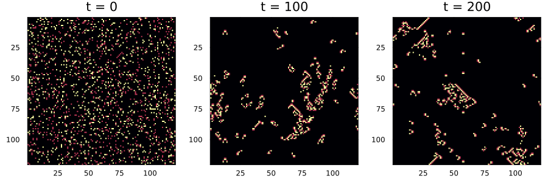
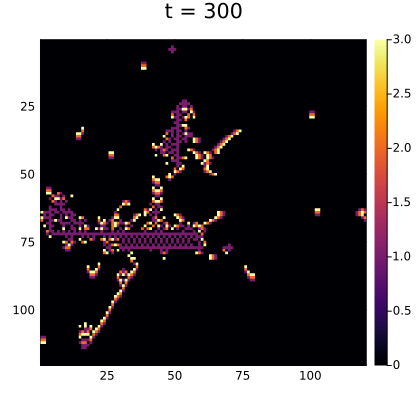
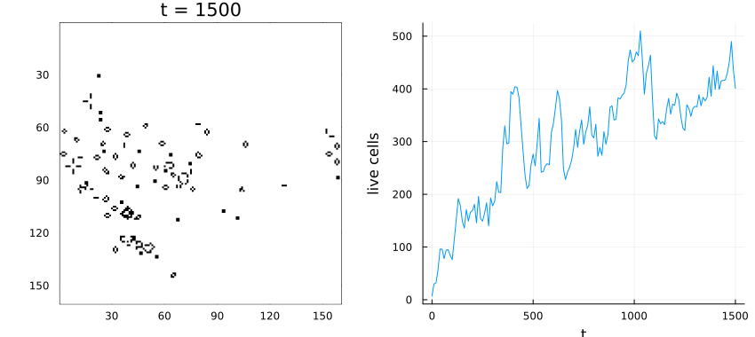

# Rule families
Simon Frost

- [Overview](#overview)
- [Wolfram codes](#wolfram-codes)
  - [More states](#more-states)
  - [Wider and one-sided windows](#wider-and-one-sided-windows)
- [Totalistic rules](#totalistic-rules)
- [Life-like rules](#life-like-rules)
  - [HighLife’s replicator](#highlifes-replicator)
- [Generations rules](#generations-rules)
- [Reading and writing patterns](#reading-and-writing-patterns)
- [Checking rules against their
  definitions](#checking-rules-against-their-definitions)

## Overview

`CellularAutomataCore.jl` has four built-in families of rules, each
specified by a number or a short string:

| family | space | specified by |
|----|----|----|
| `Wolfram` | one-dimensional | a code number, states, radius |
| `Totalistic` | one-dimensional | a code number, states, radius |
| `Life` | any lattice or graph | a birth/survival string such as `"B3/S23"` |
| `Generations` | any lattice or graph | a string such as `"B2/S/C3"` |

Any other rule can be written as a function ([custom local
rules](04_custom_local_rules.md)). This
vignette also covers reading and writing patterns in the
run-length-encoded (RLE) format.

``` julia
ENV["GKSwstype"] = "100"
using CellularAutomataCore
using Plots
using Random
spacetime(rule, u, n; kw...) = plot(solve(CAProblem(rule, u, n)); c=:binary, colorbar=false,
                                    xlabel="", ylabel="", kw...)
```

## Wolfram codes

A `Wolfram(code; states=k, radius=r)` rule reads the window of $2r + 1$
cells centred on a cell, interprets their states left to right as a
base-$k$ number $i$, and sets the cell to digit $i$ of `code` written in
base $k$. For rule 30 the eight digits, from window `000` to window
`111`, are:

``` julia
digits(30; base=2, pad=8)
```

    8-element Vector{Int64}:
     0
     1
     1
     1
     1
     0
     0
     0

so the window `100` (number 4) maps to digit 4 of the code, a `1`.

### More states

With three states there are $3^3 = 27$ windows and
$3^{27} \approx 7.6 \times
10^{12}$ rules. Most random codes are chaotic:

``` julia
rng = Xoshiro(7)
u = Int8.(rand(rng, 0:2, 200))
codes = [rand(rng, 0:(big(3)^27 - 1)) for _ in 1:4]
plot([spacetime(Wolfram(c; states=3), u, 120; c=:viridis, title="") for c in codes]...;
     layout=(2, 2), size=(800, 600))
```



### Wider and one-sided windows

`radius` can be a tuple `(left, right)`. A rule with radius `(1, 0)`
reads only the cell and its left neighbour, so information flows only
rightwards. Code 6 (binary `0110`) makes each cell the exclusive-or of
itself and its left neighbour, which is elementary rule 60:

``` julia
u = Int8.(rand(Xoshiro(2), 0:1, 101))
final_state(solve(CAProblem(Wolfram(6; radius=(1, 0)), u, 40))) ==
    final_state(solve(CAProblem(Wolfram(60), u, 40)))
```

    true

``` julia
spacetime(Wolfram(6; radius=(1, 0)), single_seed(101), 60; size=(700, 350),
          title="Wolfram(6; radius=(1, 0))")
```



Radius-2 rules read five cells and have $2^{32}$ codes:

``` julia
spacetime(Wolfram(1_635_609_034; radius=2), Int8.(rand(Xoshiro(3), 0:1, 200)), 120;
          size=(700, 400), title="a radius-2 rule")
```



## Totalistic rules

A totalistic rule depends only on the **sum** of the states in the
window, which keeps the number of rules manageable for more states. With
$k$ states and radius $r$ the sum ranges over
$0, \ldots, (2r + 1)(k - 1)$, and digit $s$ of the code (in base $k$) is
the new state for sum $s$. Code 1599 with three states is one of
Wolfram’s examples of long, irregular transients:

``` julia
spacetime(Totalistic(1599; states=3), single_seed(301), 300;
          c=:viridis, size=(700, 500), title="Totalistic(1599; states=3)")
```



## Life-like rules

`Life` covers the two-state “outer totalistic” rules on any lattice: a
dead cell is born if its number of live neighbours is in the birth set,
and a live cell survives if the number is in the survival set. Rules are
written in B/S notation; the older S/B notation is also read.

``` julia
Life("B36/S23"), Life("23/36")
```

    (Life("B36/S23"), Life("B36/S23"))

Several well-known rules have names:

``` julia
sort([string(k) => v for (k, v) in LIFE_PRESETS])
```

    11-element Vector{Pair{String, String}}:
                 "conway" => "B3/S23"
          "day_and_night" => "B3678/S34678"
               "diamoeba" => "B35678/S5678"
               "highlife" => "B36/S23"
     "life_without_death" => "B3/S012345678"
                   "maze" => "B3/S12345"
                 "morley" => "B368/S245"
             "replicator" => "B1357/S1357"
                  "seeds" => "B2/S"
            "thirty_four" => "B34/S34"
             "two_by_two" => "B36/S125"

The same random start gives very different results under different
rules:

``` julia
soup = Int8.(rand(Xoshiro(11), 0:1, 100, 100))
presets = [:conway, :day_and_night, :maze, :diamoeba, :two_by_two, :seeds]
panels = map(presets) do name
    u = name == :seeds ? place!(zeros(Int8, 100, 100), soup[1:6, 1:6]) : soup
    plot(solve(CAProblem(Life(name), u, 120)); c=:binary, colorbar=false,
         title="$(name) ($(rulestring(Life(name))))", titlefontsize=9)
end
plot(panels...; layout=(2, 3), size=(900, 620))
```



(Seeds grows explosively from almost any pattern, so it was started from
a small 6 × 6 seed rather than the whole soup.)

### HighLife’s replicator

HighLife (`B36/S23`) differs from Conway’s rule only in that six
neighbours also cause a birth. That small change makes room for a
replicator, a pattern that copies itself:

``` julia
replicator, _ = parse_rle(raw"""
x = 5, y = 5, rule = B36/S23
2b3o$bo2bo$o3bo$o2bo$3o!
""")
u = place!(zeros(Int8, 96, 96), replicator)
sol = solve(CAProblem(Life(:highlife), u, 96); saveat=24)
plot([plot(sol; snapshot=i, c=:binary, colorbar=false) for i in 2:5]...;
     layout=(1, 4), size=(900, 260))
```



## Generations rules

`Generations` rules add dying states. A live cell that does not survive
does not die at once but passes through states `2, …, C - 1` before
becoming dead; dying cells neither count as live neighbours nor can be
reborn. Brian’s Brain (`B2/S/C3`) has no survival at all, so every live
cell dies after one step and spends one step dying, which produces
streams of moving “brains”:

``` julia
soup3 = Int8.(rand(Xoshiro(5), 0:2, 120, 120) .* (rand(Xoshiro(6), 120, 120) .< 0.2))
sol = solve(CAProblem(Generations(:brians_brain), soup3, 200); saveat=100)
plot([plot(sol; snapshot=i, c=:inferno, colorbar=false) for i in 1:3]...; layout=(1, 3),
     size=(900, 300))
```



Star Wars (`B2/S345/C4`) adds survival and a longer decay:

``` julia
sol = solve(CAProblem(Generations(:star_wars), soup3, 300))
plot(sol; c=:inferno, size=(420, 400))
```



With `C = 2` a Generations rule is the Life rule with the same B/S:

``` julia
u = Int8.(rand(Xoshiro(9), 0:1, 40, 40))
final_state(solve(CAProblem(Generations("B3/S23/C2"), u, 50))) ==
    final_state(solve(CAProblem(Life(), u, 50)))
```

    true

## Reading and writing patterns

`parse_rle` reads run-length-encoded text, the format used by Golly and
the LifeWiki: `b` is a dead cell, `o` a live one, a number repeats the
next tag, `$` ends a row and `!` ends the pattern. It returns the
pattern (rows top to bottom) and the rule named in the header, if any.

``` julia
acorn, rule = parse_rle(raw"""
#N Acorn
#C A methuselah: on an unbounded plane these seven cells take 5206 generations to stabilise.
x = 7, y = 3, rule = B3/S23
bo5b$3bo3b$2o2b3o!
""")
acorn, rule
```

    (Int8[0 1 … 0 0; 0 0 … 0 0; 1 1 … 1 1], "B3/S23")

On a 160 × 160 torus the acorn’s debris wraps around and interacts, so
it settles differently, but it still grows for a long time:

``` julia
u = place!(zeros(Int8, 160, 160), acorn)
sol = solve(CAProblem(Life(rule), u, 1500); saveat=10)
plot(plot(sol; c=:binary, colorbar=false),
     plot(sol.t, [count(==(1), x) for x in sol.u]; xlabel="t", ylabel="live cells",
          legend=false);
     layout=(1, 2), size=(850, 380))
```



`rle_string` and `write_rle` go the other way. Patterns with more than
two states use `.` for 0 and `A`, `B`, … for 1, 2, …:

``` julia
print(rle_string(replicator; rule=Life(:highlife)))
print(rle_string(Int8[0 1 2; 2 1 0]; rule=Generations(:brians_brain)))
```

    x = 5, y = 5, rule = B36/S23
    2b3o$bo2bo$o3bo$o2bo$3o!
    x = 3, y = 2, rule = B2/S/C3
    .AB$BA!

and `parse_rle` reads them back:

``` julia
parse_rle(rle_string(acorn))[1] == acorn
```

    true

## Checking rules against their definitions

Each family is tested against an independent implementation written from
its definition. For example, rule 90 from a single seed must reproduce
Pascal’s triangle modulo 2:

``` julia
n, T = 65, 32
sol = solve(CAProblem(Wolfram(90), single_seed(n), T))
c = cld(n, 2)
all(sol.u[t + 1][c + x] == (iseven(t + x) && isodd(binomial(t, (t + x) ÷ 2)))
    for t in 0:T for x in (-t):t)
```

    true
