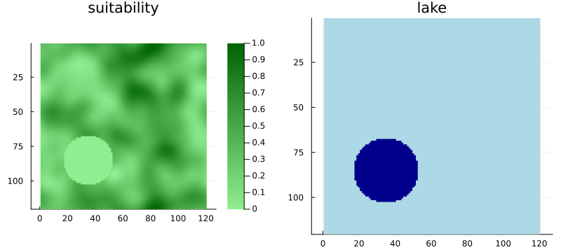
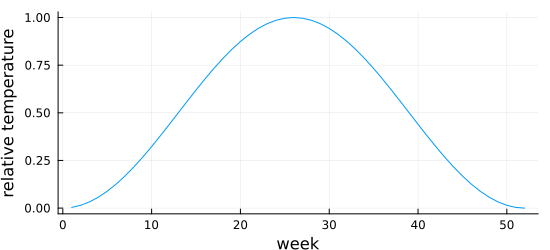
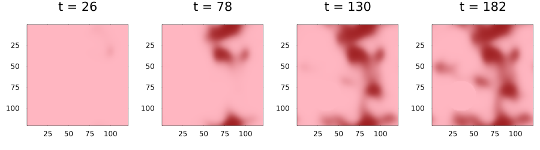
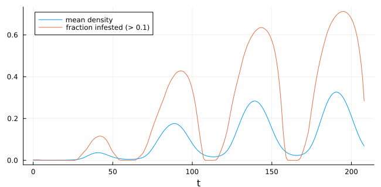
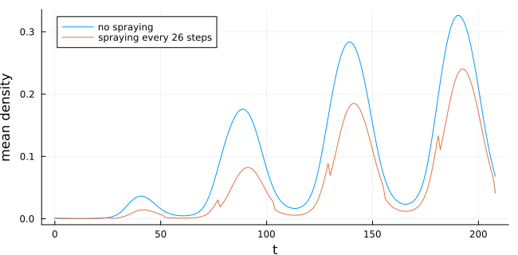
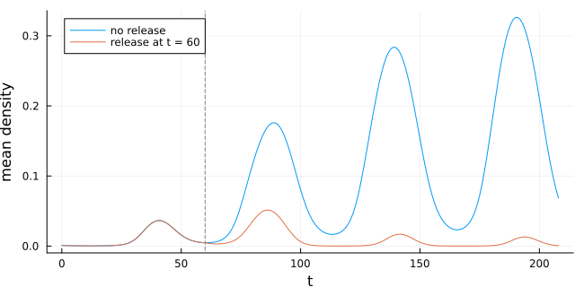
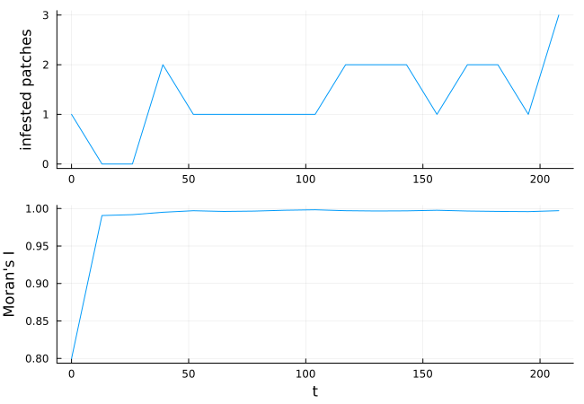

# Landscapes and interventions
Simon Frost

- [Overview](#overview)
- [A landscape](#a-landscape)
- [Seasons as a time-varying
  covariate](#seasons-as-a-time-varying-covariate)
- [The model](#the-model)
- [Recording a summary with a
  callback](#recording-a-summary-with-a-callback)
- [Interventions](#interventions)
  - [Spraying on a schedule](#spraying-on-a-schedule)
  - [Changing parameters](#changing-parameters)
  - [Responding to detection](#responding-to-detection)
- [Spatial measures](#spatial-measures)

## Overview

Real landscapes are not uniform, seasons change, and people intervene.
This vignette builds a plant-pest model step by step:

- **covariates**: layers of environmental data the rule reads at each
  cell, fixed (host suitability) or changing in time (season);
- **masks**: cells that never change, such as lakes, roads or urban
  areas;
- **callbacks**: interventions applied during a run (spraying on a
  schedule, culling when infection is detected), using SciMLBase’s
  callback interface;
- **measures**: summaries of the spatial pattern (cluster sizes, Moran’s
  I), recorded with a `SavingCallback`.

``` julia
ENV["GKSwstype"] = "100"
using CellularAutomataCore
using Plots
using Random
using Statistics
using FFTW
```

## A landscape

Host suitability between 0 and 1, made by smoothing random noise with a
Gaussian kernel field (one step of a rule that returns the field), and a
lake in which nothing grows.

``` julia
n = 120
noise = rand(Xoshiro(7), n, n)
smooth = LocalRule((c, nbrs, ctx) -> field(ctx, :s))
s = final_state(solve(CAProblem(smooth, noise, 1;
                                fields=(s=KernelField(GaussianKernel(6.0), identity; method=:fft),))))
suitability = (s .- minimum(s)) ./ (maximum(s) - minimum(s))
lake = [hypot(i - 85, j - 35) < 18 for i in 1:n, j in 1:n]
suitability[lake] .= 0
plot(heatmap(suitability; c=:greens, yflip=true, aspect_ratio=:equal, title="suitability"),
     heatmap(lake; c=:blues, yflip=true, aspect_ratio=:equal, title="lake", colorbar=false);
     layout=(1, 2), size=(800, 360))
```



## Seasons as a time-varying covariate

A covariate with one more axis than the space is read at slice
`mod1(t + 1, nt)`, so it repeats every `nt` steps. A 52-step “year” with
a warm breeding season:

``` julia
year = 52
temperature = [0.5 + 0.5 * cos(2π * (w - 26) / year) for w in 1:year]
season = reshape(temperature, 1, 1, year) .* ones(n, n, year)
plot(1:year, temperature; xlabel="week", ylabel="relative temperature", legend=false,
     size=(550, 250))
```



## The model

Each cell holds a pest density between 0 and 1. Pests grow logistically
at a rate set by suitability and temperature, disperse by a kernel
field, and suffer constant mortality. The lake is masked, so it never
changes.

``` julia
pest = LocalRule() do cell, nbrs, ctx
    (; r, m, d) = ctx.p
    growth = r * covariate(ctx, :suitability) * covariate(ctx, :season)
    x = (1 - d) * cell + d * field(ctx, :immigration)
    return clamp(x + growth * x * (1 - x) - m * x, 0.0, 1.0)
end

u0 = zeros(n, n)
u0[20:24, 95:99] .= 0.5
covariates = (suitability=suitability, season=season)
fields = (immigration=KernelField(ExponentialKernel(2.0; radius=10), identity; method=:fft),)
p = (r=0.9, m=0.15, d=0.3)
prob = CAProblem(pest, u0, 4year, p; covariates, fields, mask=.!lake, seed=1)
sol = solve(prob; saveat=year ÷ 2)
plot([plot(sol; snapshot=i, c=:reds, clims=(0, 1), colorbar=false) for i in 2:2:9]...;
     layout=(1, 4), size=(900, 250))
```



The pests spread from their starting patch in the north-east into the
most suitable parts of the landscape, their density rising each warm
season, and never enter the lake (the pale disc at lower left stays at
zero).

## Recording a summary with a callback

`SavingCallback(save_func, saved_values)` evaluates
`save_func(u, t, integ)` after every step and stores the result, here
the mean density and the area infested:

``` julia
summary = SavedValues(Int, NTuple{2,Float64})
cb = SavingCallback((u, t, integ) -> (mean(u[.!lake]), mean(u[.!lake] .> 0.1)), summary)
solve(prob; callback=cb, save_everystep=false)
plot(summary.t, [first.(summary.saveval) last.(summary.saveval)];
     label=["mean density" "fraction infested (> 0.1)"], xlabel="t", size=(650, 320))
```



## Interventions

### Spraying on a schedule

`PeriodicCallback(affect!, Δt)` runs `affect!(integ)` every `Δt` steps.
Its `affect!` may change the state in place through `integ.u`. Here a
block of fields is sprayed every 26 steps, killing 90% of the pests in
it:

``` julia
sprayed = falses(n, n)
sprayed[1:60, 60:n] .= true
spray = PeriodicCallback(26) do integ
    integ.u[sprayed] .*= 0.1
end
with_spray = SavedValues(Int, Float64)
record = SavingCallback((u, t, integ) -> mean(u[.!lake]), with_spray)
sol_spray = solve(prob; callback=CallbackSet(spray, record), saveat=year)
without = SavedValues(Int, Float64)
solve(prob; callback=SavingCallback((u, t, integ) -> mean(u[.!lake]), without),
      save_everystep=false)
plot(without.t, without.saveval; label="no spraying", xlabel="t", ylabel="mean density",
     size=(650, 320))
plot!(with_spray.t, with_spray.saveval; label="spraying every 26 steps")
```



### Changing parameters

An intervention can also change a rate.
`PresetTimeCallback(times, affect!)` runs at given times; reassigning
`integ.p` changes the parameters from the next step on. Here a
biological control agent released at `t = 60` doubles pest mortality:

``` julia
release = PresetTimeCallback([60], integ -> (integ.p = merge(integ.p, (m=0.3,))))
after_release = SavedValues(Int, Float64)
solve(prob; callback=CallbackSet(release,
                                 SavingCallback((u, t, i) -> mean(u[.!lake]), after_release)),
      save_everystep=false)
plot(without.t, without.saveval; label="no release", xlabel="t", ylabel="mean density",
     size=(650, 320))
plot!(after_release.t, after_release.saveval; label="release at t = 60")
vline!([60]; color=:grey, linestyle=:dash, label="")
```



### Responding to detection

A `DiscreteCallback(condition, affect!)` runs `affect!` whenever
`condition(u, t, integ)` is true. Here surveillance detects any cell
above a density of 0.6 and culls a 5-cell radius around each detection,
and the run stops (`terminate!`) once the pest has been eradicated:

``` julia
detected(u, t, integ) = any(>(0.6), u)
function cull!(integ)
    u = integ.u
    hits = findall(>(0.6), u)
    for I in hits, J in CartesianIndices(u)
        hypot(Tuple(I - J)...) <= 5 && (u[J] = 0.0)
    end
    return nothing
end
eradicated(u, t, integ) = all(<(1e-3), u)
cbs = CallbackSet(DiscreteCallback(detected, cull!),
                  DiscreteCallback(eradicated, integ -> terminate!(integ)))
sol_cull = solve(prob; callback=cbs, saveat=year)
sol_cull.retcode, sol_cull.t[end]
```

    (SciMLBase.ReturnCode.Success, 208)

## Spatial measures

`cluster_sizes` finds connected patches of cells satisfying a condition,
and `morans_i` measures spatial autocorrelation (near 1 for smooth
patches, near 0 for no pattern). Over the uncontrolled run:

``` julia
sol = solve(prob; saveat=13)
infested(u) = u .> 0.1
clusters = [isempty(cluster_sizes(infested(u))) ? 0 : length(cluster_sizes(infested(u)))
            for u in sol.u]
moran = [all(iszero, u) ? NaN : morans_i(u) for u in sol.u]
plot(plot(sol.t, clusters; ylabel="infested patches", legend=false),
     plot(sol.t, moran; ylabel="Moran's I", xlabel="t", legend=false);
     layout=(2, 1), size=(650, 450))
```


