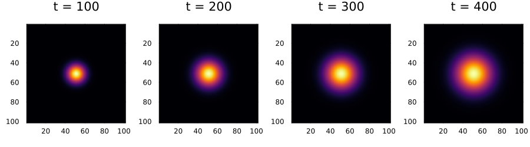
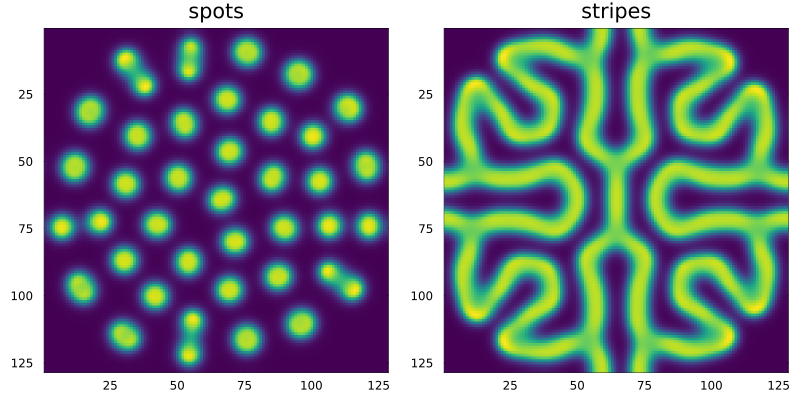
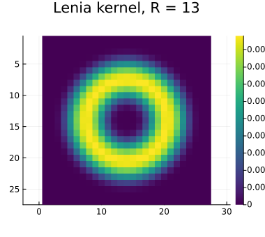
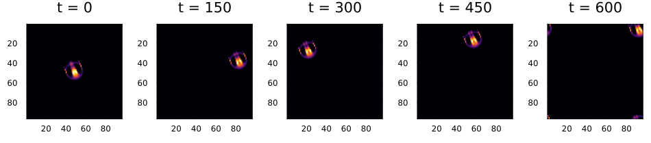
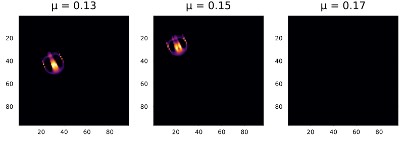

# Continuous states and Lenia
Simon Frost

- [Overview](#overview)
- [Diffusion](#diffusion)
- [Reaction–diffusion: the Gray–Scott
  model](#reactiondiffusion-the-grayscott-model)
- [Lenia](#lenia)
- [References](#references)

## Overview

Cell states need not be discrete. With floating-point states a cellular
automaton becomes a discretised field model: diffusion,
reaction–diffusion, and continuous automata such as Lenia, whose
“creatures” glide like Life’s gliders. This vignette works through all
three.

``` julia
ENV["GKSwstype"] = "100"
using CellularAutomataCore
using Plots
using FFTW
```

## Diffusion

Each cell moves towards the mean of its four neighbours, the explicit
finite-difference scheme for the heat equation:

``` julia
diffusion = LocalRule(VonNeumann(1)) do u, nbrs, ctx
    u + ctx.p.D * (sum(nbrs) - 4u)
end
u0 = zeros(101, 101)
u0[51, 51] = 1.0
sol = solve(CAProblem(diffusion, u0, 400, (D=0.2,)); saveat=100)
plot([plot(sol; snapshot=i, c=:inferno, colorbar=false) for i in 2:5]...; layout=(1, 4),
     size=(900, 250))
```



On a torus the total is conserved, up to rounding:

``` julia
extrema(sum.(sol.u))
```

    (1.0, 1.0000000000000002)

and the variance grows linearly, as $2 \cdot 2 D t$ in two dimensions:

``` julia
variance(x) = sum(((I[1] - 51)^2 + (I[2] - 51)^2) * x[I] for I in CartesianIndices(x)) / sum(x)
[(t, variance(x), 4 * 0.2 * t) for (t, x) in zip(sol.t, sol.u)]
```

    5-element Vector{Tuple{Int64, Float64, Float64}}:
     (0, 0.0, 0.0)
     (100, 79.9999999999994, 80.0)
     (200, 159.99999099553636, 160.0)
     (300, 239.99652515612348, 240.0)
     (400, 319.92520054236303, 320.0)

## Reaction–diffusion: the Gray–Scott model

Two chemicals, `u` and `v`, as a layered state. `v` consumes `u` to make
more `v` ($u + 2v \to 3v$), `u` is fed at rate $F$ and `v` removed at
rate $F + k$, and both diffuse. The Laplacian uses the nine-point
stencil: weight $0.2$ on the edge neighbours and $0.05$ on the diagonal
ones. In the Moore neighbourhood’s offset order (first axis fastest),
the diagonal neighbours are entries 1, 3, 6 and 8.

``` julia
neighbourhood_offsets(Moore(1), Torus(3, 3))
```

    Offsets((-1, -1), (0, -1), (1, -1), (-1, 0), (1, 0), (-1, 1), (0, 1), (1, 1))

``` julia
const DIAGONAL = (1, 3, 6, 8)
const EDGE = (2, 4, 5, 7)
laplacian(c, nbrs, layer) =
    0.2 * sum(getfield(nbrs[i], layer) for i in EDGE) +
    0.05 * sum(getfield(nbrs[i], layer) for i in DIAGONAL) - getfield(c, layer)

gray_scott = LocalRule(Moore(1)) do c, nbrs, ctx
    (; Du, Dv, F, k) = ctx.p
    uvv = c.u * c.v^2
    (u=c.u + Du * laplacian(c, nbrs, :u) - uvv + F * (1 - c.u),
     v=c.v + Dv * laplacian(c, nbrs, :v) + uvv - (F + k) * c.v)
end

n = 128
u0 = (u=ones(n, n), v=zeros(n, n))
u0.u[56:72, 56:72] .= 0.5
u0.v[56:72, 56:72] .= 0.25 .+ 0.05 .* rand(17, 17)
patterns = ["spots" => (F=0.0367, k=0.0649), "stripes" => (F=0.06, k=0.062)]
plot([plot(solve(CAProblem(gray_scott, u0, 6000, merge((Du=1.0, Dv=0.5), p));
                 save_everystep=false); layer=:v, c=:viridis, colorbar=false, title=name)
      for (name, p) in patterns]...; layout=(1, 2), size=(800, 400))
```



With $F = 0.0367$, $k = 0.0649$ the initial square breaks into spots
that keep dividing until they fill the lattice; with $F = 0.06$,
$k = 0.062$ it grows into a labyrinth of stripes. The same rule, with
different feed and kill rates.

## Lenia

Lenia ([Chan 2019](#ref-Chan2019)) is a continuous generalisation of the
Game of Life. Each cell holds a value in $[0, 1]$. At every step it
computes a potential $U$, a weighted average of the cells around it with
a smooth ring-shaped kernel of radius $R$, and grows or shrinks by
$\Delta t \, G(U)$, where $G(U) = 2 \exp(-(U - \mu)^2 / 2\sigma^2) - 1$
is positive only when $U$ is close to $\mu$.

`Lenia(; R, μ, σ, dt)` is a rule whose potential is its own kernel
field. With `method = :fft` the field is computed by FFT, which for
$R = 13$ (a 27 × 27 kernel) is much faster than summing directly.

``` julia
heatmap(begin
            offsets, weights = kernel_weights(LeniaKernel(13), Torus(27, 27))
            m = zeros(27, 27)
            for (o, w) in zip(offsets, weights)
                m[CartesianIndex(Tuple(o) .+ 14)] = w
            end
            m
        end; aspect_ratio=:equal, yflip=true, c=:viridis, title="Lenia kernel, R = 13",
        size=(380, 340))
```



*Orbium unicaudatus* is Lenia’s glider. `ORBIUM` holds its 20 × 20 seed;
on a torus it travels steadily without losing shape.

``` julia
u = zeros(96, 96)
place!(u, ORBIUM, (38, 38))
sol = solve(CAProblem(Lenia(; method=:fft), u, 600); saveat=150)
plot([plot(sol; snapshot=i, c=:inferno, clims=(0, 1), colorbar=false) for i in 1:5]...;
     layout=(1, 5), size=(950, 210))
```



``` julia
mass = sum.(sol.u)
[(t, round(m; digits=1)) for (t, m) in zip(sol.t, mass)]
```

    5-element Vector{Tuple{Int64, Float64}}:
     (0, 75.1)
     (150, 71.1)
     (300, 71.1)
     (450, 70.9)
     (600, 71.3)

Small changes to the parameters destroy it. With $\mu$ slightly too low
the creature fades away; slightly too high and it grows into a blob:

``` julia
outcomes = map((0.13, 0.15, 0.17)) do μ
    s = solve(CAProblem(Lenia(; μ, method=:fft), u, 300); save_everystep=false)
    plot(s; c=:inferno, clims=(0, 1), colorbar=false, title="μ = $μ")
end
plot(outcomes...; layout=(1, 3), size=(800, 280))
```



## References

```@raw html
<div id="refs" class="references csl-bib-body hanging-indent">
```

```@raw html
<div id="ref-Chan2019" class="csl-entry">
```

Chan, Bert Wang-Chak. 2019. “Lenia: Biology of Artificial Life.”
*Complex Systems* 28 (3): 251–86.
<https://doi.org/10.25088/ComplexSystems.28.3.251>.

```@raw html
</div>
```

```@raw html
</div>
```
