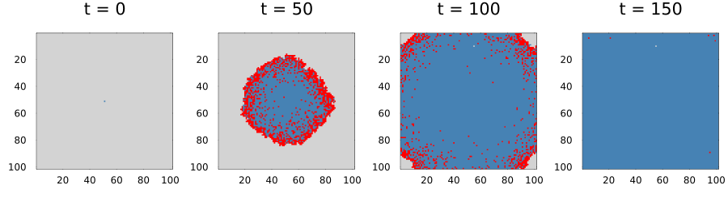
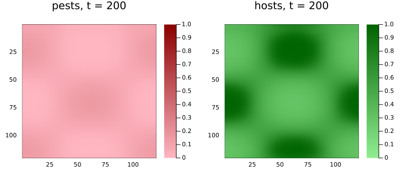
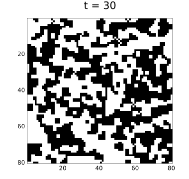

# Models and problems
Simon Frost

- [Overview](#overview)
- [Declaring a model](#declaring-a-model)
- [From model to problem](#from-model-to-problem)
- [Several state variables](#several-state-variables)
- [Without the macro](#without-the-macro)

## Overview

So far each vignette built a rule and an initial state by hand and
passed them to `CAProblem`. For models that are reused, shared and
varied, it is clearer to declare them once, in the style of
ModelingToolkit: name the state variables with their defaults and
allowed values, name the parameters with their defaults, and write the
rule using those names. A `CAModel` is that declaration;
`CAProblem(model, u0map, tspan, pmap; space)` turns it into a problem by
mapping names to values, as ModelingToolkit’s
`ODEProblem(sys, u0map, tspan, pmap)` does.

``` julia
ENV["GKSwstype"] = "100"
using CellularAutomataCore
using Plots
```

## Declaring a model

`@camodel` reads a block of declarations. Inside `@rule`, `cell` is the
cell’s state, `nbrs` its neighbours’ states, `ctx` its context, and
every parameter is available by name.

``` julia
sir = @camodel SIR begin
    @description "Lattice SIR epidemic with per-contact infection"
    @states state::Symbol = :S ∈ (:S, :I, :R)
    @parameters β = 0.3 γ = 0.1
    @neighbourhood VonNeumann(1)
    @rule begin
        if cell == :S
            bernoulli(ctx, 1 - (1 - β)^count(==(:I), nbrs), 1) ? :I : :S
        elseif cell == :I
            bernoulli(ctx, γ, 2) ? :R : :I
        else
            cell
        end
    end
end
```

    CAModel SIR
      Lattice SIR epidemic with per-contact infection
      states:
        state::Symbol = :S ∈ (:S, :I, :R)
      parameters:
        β = 0.3
        γ = 0.1
      rule: LocalRule(<anonymous function>, VonNeumann(1))

The model knows its states, parameters and defaults:

``` julia
[s.name for s in states(sir)], defaults(sir)
```

    ([:state], (β = 0.3, γ = 0.1))

## From model to problem

`u0map` gives each state variable a value for every cell, an array, or a
function of the cell’s index; variables it leaves out take their
defaults. `pmap` overrides parameter defaults. Values outside a state’s
domain, and names the model does not have, are rejected.

``` julia
centre(I) = I == CartesianIndex(51, 51) ? :I : :S
prob = CAProblem(sir, (state=centre,), 150, (β=0.5,); space=Torus(101, 101), seed=1)
prob.p
```

    (β = 0.5, γ = 0.1)

``` julia
code(s) = s == :S ? 0 : s == :I ? 1 : 2
sol = solve(prob; saveat=50)
plot([plot(Torus(101, 101), code.(u); c=[:lightgrey, :red, :steelblue], colorbar=false,
           title="t = $t") for (t, u) in zip(sol.t, sol.u)]...; layout=(1, 4), size=(900, 250))
```



``` julia
try
    CAProblem(sir, (state=:Z,), 10; space=Torus(5, 5))
catch e
    println(sprint(showerror, e))
end
```

    InvalidStateError in model SIR: cell CartesianIndex(1, 1) has value :Z; state state must lie in (:S, :I, :R)

Because a problem is ordinary, everything else applies unchanged:
backends, update schemes, callbacks, `remake` and ensembles.

``` julia
ens = solve(EnsembleProblem(prob; output_func=(sol, ctx) -> (count(==(:R), final_state(sol)), false)),
            Synchronous(), EnsembleThreads(); trajectories=8, save_everystep=false)
ens.u
```

    8-element Vector{Int64}:
     10191
         1
     10197
     10193
     10194
     10192
     10195
     10191

## Several state variables

A model with more than one state variable has a layered state: each cell
is a `NamedTuple`, and so is the rule’s result. Here a host plant and a
pest, with pests dispersing by a kernel field and growing according to a
suitability covariate that every problem must supply:

``` julia
hostpest = @camodel HostPest begin
    @description "Pests disperse by a Gaussian kernel and grow on healthy hosts"
    @states host::Float64 = 1.0 pest::Float64 = 0.0
    @parameters r = 0.8 m = 0.2 damage = 0.3 recovery = 0.02
    @fields spores = KernelField(GaussianKernel(2.0), c -> c.pest)
    @covariates suitability
    @rule begin
        growth = r * covariate(ctx, :suitability) * cell.host
        pest = clamp(0.5 * cell.pest + 0.5 * field(ctx, :spores) +
                     growth * cell.pest * (1 - cell.pest) - m * cell.pest, 0.0, 1.0)
        host = clamp(cell.host + recovery * (1 - cell.host) - damage * pest * cell.host, 0.0, 1.0)
        (host=host, pest=pest)
    end
end
```

    CAModel HostPest
      Pests disperse by a Gaussian kernel and grow on healthy hosts
      states:
        host::Float64 = 1.0
        pest::Float64 = 0.0
      parameters:
        r = 0.8
        m = 0.2
        damage = 0.3
        recovery = 0.02
      fields: spores
      covariates: suitability
      rule: LocalRule(<anonymous function>)

``` julia
n = 120
suitability = [0.5 + 0.5 * sin(i / 15) * cos(j / 20) for i in 1:n, j in 1:n]
start = (pest=I -> I == CartesianIndex(60, 60) ? 0.5 : 0.0,)
p = CAProblem(hostpest, start, 200; space=Torus(n, n), covariates=(suitability=suitability,),
              seed=2)
sol = solve(p; saveat=100)
plot(plot(sol; layer=:pest, c=:reds, clims=(0, 1), title="pests, t = 200"),
     plot(sol; layer=:host, c=:greens, clims=(0, 1), title="hosts, t = 200");
     layout=(1, 2), size=(800, 360))
```



## Without the macro

`@camodel` is a convenience over the `CAModel` constructor, which takes
a rule and the declarations as keywords:

``` julia
majority = CAModel(LocalRule(VonNeumann(1)) do cell, nbrs, ctx
                       cell + sum(nbrs) >= 3 ? one(cell) : zero(cell)
                   end;
                   name=:Majority, states=[StateVariable(:opinion, Int8(0); domain=(0, 1))])
p = CAProblem(majority, (opinion=rand(Int8[0, 1], 80, 80),), 30; space=Torus(80, 80))
plot(solve(p; save_everystep=false); c=:binary, colorbar=false, size=(380, 360))
```



Models are the unit that `CategoricalCellularAutomata.jl` composes:
products of models become layered states, and models sharing a state
variable can be glued together.
