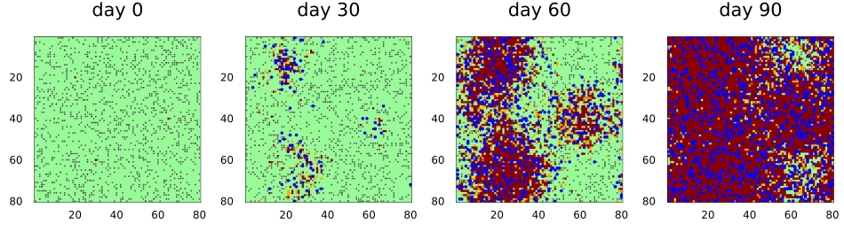
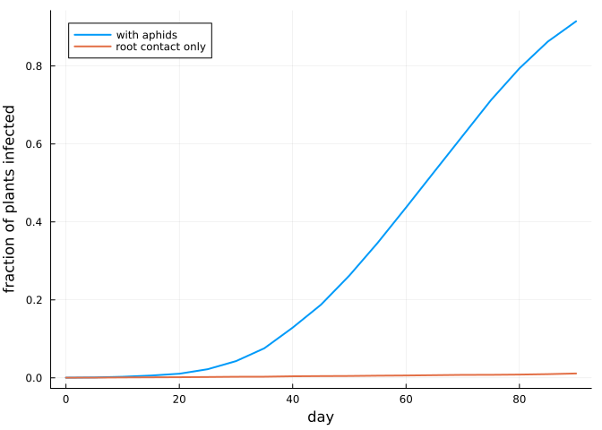
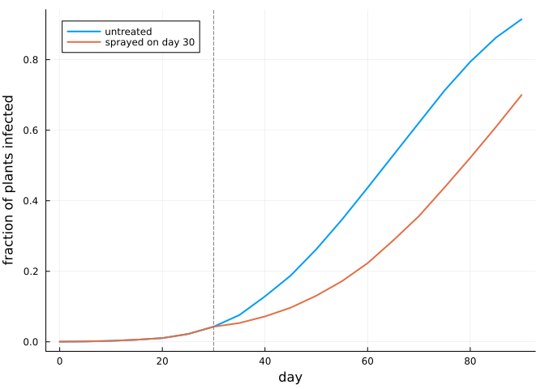
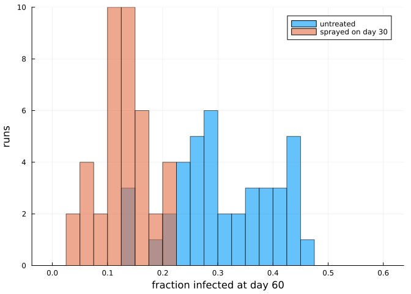

# Hybrid models with Agents.jl
Simon Frost

- [Overview](#overview)
- [The crop](#the-crop)
- [The vectors](#the-vectors)
- [A run](#a-run)
- [One agent per plant](#one-agent-per-plant)
- [Insecticide from a callback](#insecticide-from-a-callback)
- [Ensembles](#ensembles)

## Overview

Many plant pathogens are not spread from plant to plant but carried by
mobile vectors: aphids carry viruses, beetles carry fungi, farmers carry
everything on their boots and tools. A cellular automaton describes the
crop well, and an agent-based model describes the vectors well.
`AgentsBackend` combines the two. The state of the cellular automaton
lives inside an
[Agents.jl](https://juliadynamics.github.io/Agents.jl/stable/) model,
the vectors are ordinary Agents.jl agents in the same model, and each
step runs the cellular automaton’s sweep and then moves the agents.

This vignette builds an aphid-borne virus epidemic in a field, shows the
two ways of storing the crop (as a grid or as one agent per plant),
intervenes with an insecticide from a callback, and runs an ensemble.

``` julia
ENV["GKSwstype"] = "100"
using CellularAutomataCore
using Agents
using Plots
using Random
using Statistics
```

Both packages export a `GraphSpace`, so with both loaded it has to be
written qualified, as `CellularAutomataCore.GraphSpace` or
`Agents.GraphSpace`. This vignette uses neither.

## The crop

Each cell is a plant: healthy (0), infected but not yet showing symptoms
(1), or symptomatic (2). Infected plants develop symptoms after a latent
period of `τ` days on average, and a symptomatic plant infects each
healthy neighbour with a small probability `ε` per day, through root
contact. Without vectors, that is the whole model.

``` julia
crop = LocalRule(VonNeumann(1)) do cell, nbrs, ctx
    if cell == 0
        k = count(==(2), nbrs)
        return bernoulli(ctx, 1 - (1 - ctx.p.ε)^k, 1) ? Int8(1) : Int8(0)
    elseif cell == 1
        return bernoulli(ctx, 1 / ctx.p.τ, 2) ? Int8(2) : Int8(1)
    end
    return cell
end

n = 80
u0 = zeros(Int8, n, n)
for (i, j) in ((20, 20), (60, 30), (40, 65))
    u0[i, j] = 2
end
p = (ε=0.02, τ=5, inoculation=0.4, acquisition=0.6, loss=0.1, flight=3,
     emigration=0.03, immigrants=40)
prob = CAProblem(crop, u0, 90, p; seed=1)
```

    CAProblem(LocalRule(<anonymous function>, VonNeumann(1)) on Torus((80, 80)), tspan=(0, 90))

`AgentsBackend` can run this problem without any agents. The crop then
lives in the model’s properties, and the result is exactly that of the
default `ArrayBackend`.

``` julia
solve(prob; backend=AgentsBackend()).u == solve(prob).u
```

    true

## The vectors

The aphids are Agents.jl agents on a grid of the field’s size, with one
extra field: whether the aphid carries the virus. Each day an aphid may
leave the field, otherwise it flies up to `flight` cells, probes the
plant it lands on, and may infect it or pick up the virus from it. A
non-persistent virus is lost again after a while. New aphids fly in
every day.

The aphids reach the crop through `read_cell(model, pos)` and
`write_cell!(model, pos, value)`, and the parameters of the problem
through `model.p`. Their random numbers come from `abmrng(model)`, which
the backend seeds from the problem’s seed, so a run is reproducible.

``` julia
@agent struct Aphid(GridAgent{2})
    viruliferous::Bool
end

function aphid_step!(aphid, model)
    rng, p = abmrng(model), model.p
    if rand(rng) < p.emigration
        remove_agent!(aphid, model)
        return
    end
    randomwalk!(aphid, model, p.flight; ifempty=false)
    plant = read_cell(model, aphid.pos)
    if aphid.viruliferous && plant == 0 && rand(rng) < p.inoculation
        write_cell!(model, aphid.pos, 1)
    end
    if plant == 2 && rand(rng) < p.acquisition
        aphid.viruliferous = true
    elseif rand(rng) < p.loss
        aphid.viruliferous = false
    end
    return
end

immigrate!(model) = foreach(_ -> add_agent!(Aphid, model; viruliferous=false),
                            1:model.p.immigrants)
colonise!(model) = foreach(_ -> add_agent!(Aphid, model; viruliferous=false), 1:1500)
```

    colonise! (generic function with 1 method)

The backend takes the agent type and three functions: `init!` adds the
first agents once the crop is set, `agent_step!` is called for every
aphid after each sweep of the crop, and `model_step!` once per step
after that.

``` julia
aphids = AgentsBackend(:grid; agent_type=Aphid, init! =colonise!,
                       agent_step! =aphid_step!, model_step! =immigrate!)
```

    AgentsBackend(:grid; agent_type=Main.Notebook.Aphid)

## A run

`agent_model(integ)` returns the Agents.jl model behind an integrator. A
`SavingCallback` uses it to record where the aphids are, alongside the
saved states of the crop.

``` julia
positions = SavedValues(Int, Vector{Tuple{Int,Int,Bool}})
record(u, t, integ) = [(a.pos..., a.viruliferous) for a in allagents(agent_model(integ))]
sol = solve(prob; backend=aphids, saveat=30,
            callback=SavingCallback(record, positions; saveat=30))
panels = map(eachindex(sol.t)) do i
    plot(sol; snapshot=i, c=[:palegreen, :orange, :darkred], clims=(0, 2),
         colorbar=false, title="day $(sol.t[i])")
    a = positions.saveval[i]
    carriers = filter(last, a)
    scatter!([x[2] for x in a], [x[1] for x in a]; ms=1, msw=0, c=:grey30,
             label=nothing)
    scatter!([x[2] for x in carriers], [x[1] for x in carriers]; ms=2, msw=0,
             c=:blue, label=nothing)
end
plot(panels...; layout=(1, 4), size=(950, 270))
```



Healthy plants are green, infected plants orange and symptomatic plants
dark red; grey dots are aphids and blue dots aphids carrying the virus.
The aphids carry the virus well beyond the three initial foci, and each
satellite infection becomes a focus of its own. Without the aphids the
epidemic barely moves:

``` julia
prevalence(s) = [count(>(0), u) / length(u) for u in s.u]
dense = solve(prob; backend=aphids, saveat=5)
alone = solve(prob; saveat=5)
plot(dense.t, prevalence(dense); label="with aphids", xlabel="day",
     ylabel="fraction of plants infected", legend=:topleft, lw=2)
plot!(alone.t, prevalence(alone); label="root contact only", lw=2)
```



## One agent per plant

With `AgentsBackend(:cells)` every plant is itself an agent, with fields
`id`, `pos` and `state`, and the agent with id `i` is the plant with
linear index `i`. The crop can then be inspected with the usual
Agents.jl tools, and the aphids get ids after the plants. The backend
gathers the plants’ states into an array for each sweep and writes the
result back, so the run is exactly the same as with the grid.

Because a plant agent stands on every cell, Agents.jl functions that
look for empty cells would find none, which is why `aphid_step!` passes
`ifempty=false` to `randomwalk!`.

``` julia
plants = AgentsBackend(:cells; agent_type=Aphid, init! =colonise!,
                       agent_step! =aphid_step!, model_step! =immigrate!)
cellsol = solve(prob; backend=plants, saveat=30)
cellsol.u == sol.u
```

    true

``` julia
integ = init(prob; backend=plants)
step!(integ, 40)
model = agent_model(integ)
plant = model[LinearIndices((n, n))[40, 65]]
(plant.pos, plant.state, count(a -> a isa Aphid, allagents(model)))
```

    ((40, 65), 2, 1370)

Keeping a plant agent per cell costs a little time each step, to gather
and scatter the states:

``` julia
solve(prob; backend=aphids); solve(prob; backend=plants)
(grid=(@elapsed solve(prob; backend=aphids)), cells=(@elapsed solve(prob; backend=plants)))
```

    (grid = 0.034004083, cells = 0.036793833)

## Insecticide from a callback

Callbacks reach the agents through `agent_model`. Here an insecticide
sprayed on day 30 kills 90% of the aphids then in the field; immigration
carries on.

``` julia
function spray!(integ)
    model = agent_model(integ)
    for a in collect(allagents(model))
        rand(abmrng(model)) < 0.9 && remove_agent!(a, model)
    end
end
sprayed = solve(prob; backend=aphids, saveat=5, callback=PresetTimeCallback([30], spray!))
plot(dense.t, prevalence(dense); label="untreated", xlabel="day",
     ylabel="fraction of plants infected", legend=:topleft, lw=2)
plot!(sprayed.t, prevalence(sprayed); label="sprayed on day 30", lw=2)
vline!([30]; c=:grey, ls=:dash, label=nothing)
```



The spray buys about two weeks: the aphids flying in from outside the
field restore the population, and with it the spread.

## Ensembles

Every trajectory of an `EnsembleProblem` gets its own seed, so its own
crop draws and its own aphid random numbers. Here is the fraction of
plants infected at day 60, untreated and sprayed, over 40 runs each.

``` julia
day60 = remake(prob; tspan=(0, 60))
final_prevalence = (s, ctx) -> (count(>(0), final_state(s)) / n^2, false)
ens = EnsembleProblem(day60; output_func=final_prevalence)
untreated = solve(ens, Synchronous(), EnsembleThreads(); trajectories=40,
                  backend=aphids, save_everystep=false)
treated = solve(ens, Synchronous(), EnsembleThreads(); trajectories=40,
                backend=aphids, save_everystep=false,
                callback=PresetTimeCallback([30], spray!))
histogram(untreated.u; bins=0:0.025:0.6, alpha=0.6, label="untreated",
          xlabel="fraction infected at day 60", ylabel="runs")
histogram!(treated.u; bins=0:0.025:0.6, alpha=0.6, label="sprayed on day 30")
```


