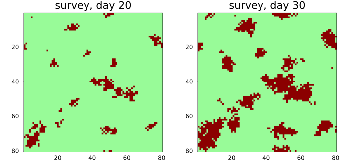
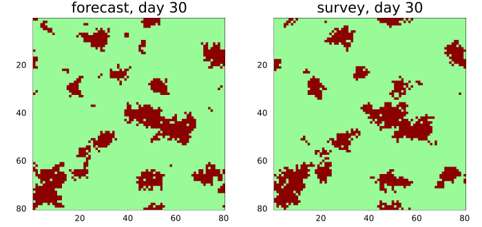
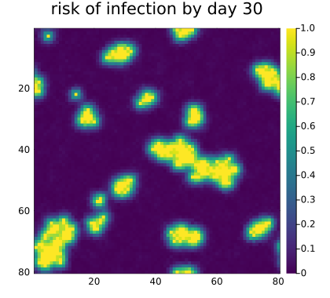
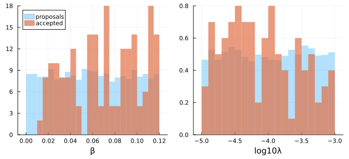
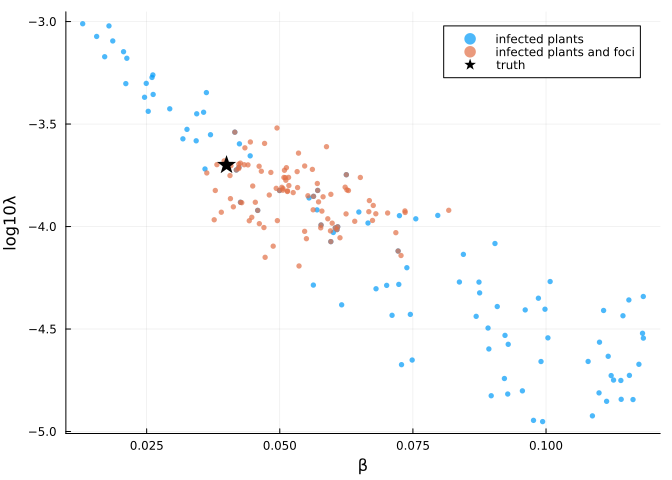
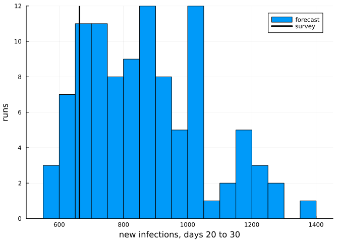

# Evaluation and calibration
Simon Frost

- [Overview](#overview)
- [A disease with two ways to
  spread](#a-disease-with-two-ways-to-spread)
- [Comparing two maps](#comparing-two-maps)
- [Risk maps](#risk-maps)
- [Calibration](#calibration)
- [Forecasting with the posterior](#forecasting-with-the-posterior)

## Overview

A model of a plant epidemic is only useful once it has been confronted
with data: maps of where the disease was found, from surveys in the
field. This vignette does the two things such maps are used for. It
**evaluates** a model, by measuring how well its forecasts agree with a
later survey, and it **calibrates** a model, by finding the parameters
under which simulations resemble a survey, with approximate Bayesian
computation.

The surveys here are simulated from a model with known parameters, so
that the answers can be checked.

``` julia
ENV["GKSwstype"] = "100"
using CellularAutomataCore
using Plots
using Random
using Statistics
```

## A disease with two ways to spread

A soil-borne disease spreads from infected plants to their eight
neighbours with probability `β` per infected neighbour per day, and
every healthy plant can also be infected from outside the field, by
wind-blown spores or a contaminated tool, with a small daily probability
`λ`. Infected plants stay infected. A rate as small and uncertain as `λ`
is best handled on a log scale, so the parameter is `log10λ`.

``` julia
spread = LocalRule(Moore(1)) do cell, nbrs, ctx
    cell == 1 && return Int8(1)
    k = count(==(1), nbrs)
    escape = (1 - ctx.p.β)^k * (1 - exp10(ctx.p.log10λ))
    return bernoulli(ctx, 1 - escape, 1) ? Int8(1) : Int8(0)
end

n = 80
u0 = zeros(Int8, n, n)
u0[40, 40] = 1
truth = (β=0.04, log10λ=-3.7)
prob = CAProblem(spread, u0, 30, truth; seed=1)
```

    CAProblem(LocalRule(<anonymous function>, Moore(1)) on Torus((80, 80)), tspan=(0, 30))

The field is surveyed on days 20 and 30. The “true” epidemic is one run
of the model, with a seed that no simulation below uses.

``` julia
field = solve(remake(prob; seed=999); saveat=[20, 30])
day20, day30 = field.u[2], field.u[3]
plot(plot(prob.space, day20; c=[:palegreen, :darkred], colorbar=false,
          title="survey, day 20"),
     plot(prob.space, day30; c=[:palegreen, :darkred], colorbar=false,
          title="survey, day 30"); layout=(1, 2), size=(700, 330))
```



There is a large focus around the first infected plant and a scatter of
smaller ones, started by infections from outside.

## Comparing two maps

Suppose the parameters are known and the model forecasts day 30 from the
survey of day 20. A forecast is a problem that starts from the survey:

``` julia
forecast = CAProblem(spread, day20, (20, 30), truth; seed=1)
predicted = final_state(solve(forecast; save_everystep=false))
plot(plot(prob.space, predicted; c=[:palegreen, :darkred], colorbar=false,
          title="forecast, day 30"),
     plot(prob.space, day30; c=[:palegreen, :darkred], colorbar=false,
          title="survey, day 30"); layout=(1, 2), size=(700, 330))
```



`confusion_counts` cross-tabulates two `Bool` maps; `cohens_kappa`
measures the agreement of two categorical maps beyond what their
category frequencies would give by chance ([Cohen
1960](#ref-Cohen1960)).

``` julia
(counts=confusion_counts(predicted .== 1, day30 .== 1),
 kappa=cohens_kappa(predicted, day30))
```

    (counts = (tp = 694, fp = 320, fn = 314, tn = 5072), kappa = 0.6276261460480795)

Kappa flatters a forecast, because every plant infected on day 20 is
still infected on day 30 and is predicted correctly by any model. The
figure of merit ([Pontius et al.
2008](#ref-Pontius2008)) looks only at change: of the plants that became
infected in the forecast or in the survey, the fraction that did so in
both.

``` julia
figure_of_merit(day20, predicted, day30)
```

    0.3550356052899288

About a third. Spread to a neighbour and infection from outside are both
random, so a single run cannot be expected to match the survey plant by
plant.

## Risk maps

A better forecast is a probability: the fraction of an ensemble of runs
in which each plant is infected on day 30. The area under the ROC curve
(`auc`) then measures how well that risk ranks the plants that were
infected above those that were not, among the plants still healthy on
day 20.

``` julia
function risk(p; trajectories=200)
    ens = EnsembleProblem(remake(forecast; p);
                          output_func=(sol, ctx) -> (final_state(sol) .== 1, false))
    runs = solve(ens, Synchronous(), EnsembleThreads(); trajectories,
                 save_everystep=false)
    return mean(runs.u)
end
healthy = day20 .== 0
infected30 = day30 .== 1
r = risk(truth)
heatmap(r; c=:viridis, aspect_ratio=:equal, yflip=true, framestyle=:box,
        xlims=(0.5, n + 0.5), ylims=(0.5, n + 0.5), title="risk of infection by day 30",
        size=(420, 380))
```



Three models can be compared this way: the true one, one with local
spread only, and one where every infection comes from outside the field.
Besides the ranking (AUC), the expected number of new infections is the
sum of the risks over healthy plants.

``` julia
models = ["true model" => truth, "local spread only" => (β=0.05, log10λ=-Inf),
          "outside infection only" => (β=0.0, log10λ=-3.0)]
[name => (auc=round(auc(r[healthy], infected30[healthy]); digits=3),
          new=round(Int, sum(r[healthy])))
 for (name, r) in ((name, risk(p)) for (name, p) in models)]
```

    3-element Vector{Pair{String, @NamedTuple{auc::Float64, new::Int64}}}:
                 "true model" => (auc = 0.942, new = 645)
          "local spread only" => (auc = 0.944, new = 780)
     "outside infection only" => (auc = 0.498, new = 61)

The survey found 663 new infections. Local spread alone ranks the plants
as well as the true model does, since most new infections are next to
old ones, but a model of infection from outside only has no idea where
the disease will be. AUC measures *where*, not *how much*: a model can
rank plants well and still get the size of the epidemic wrong, so the
two are worth checking together.

## Calibration

Now suppose the parameters are unknown, and only the survey of day 20 is
available. Rejection ABC ([Beaumont et al. 2002](#ref-Beaumont2002))
draws parameter sets from a prior, simulates the model once with each,
and keeps those whose simulations are closest to the survey. The prior
is uniform for `β`, and for `log10λ`, as `λ` is known only to within two
orders of magnitude.

``` julia
prior = rng -> (β=0.12 * rand(rng), log10λ=-5 + 2 * rand(rng))
calibrate = remake(prob; tspan=(0, 20))
```

    CAProblem(LocalRule(<anonymous function>, Moore(1)) on Torus((80, 80)), tspan=(0, 20))

The distance between a simulation and the survey can compare summaries
of the two maps. The obvious summary is the number of infected plants:

``` julia
infected(u) = count(==(1), u)
foci(u) = length(cluster_sizes(u .== 1; space=prob.space, neighbourhood=Moore(1)))
observed = (infected=infected(day20), foci=foci(day20))
```

    (infected = 345, foci = 18)

``` julia
d_infected(sol, obs) = abs(infected(final_state(sol)) - obs.infected) / obs.infected
by_count = abc_rejection(calibrate, prior, d_infected, observed; n=5000, rng=Xoshiro(1),
                         keep=100, save_everystep=false)
```

    ABCResult: 100 of 5000 proposals accepted, distances 0.0 to 0.0435

Each of the 5000 proposals is one trajectory of an `EnsembleProblem`, so
the simulations run on all threads, and the 100 closest are kept. `plot`
shows the accepted values of each parameter against the prior:

``` julia
plot(by_count; size=(700, 320), bins=30, bottom_margin=4Plots.mm)
```



The number of infected plants does not pin either parameter down,
because the two can trade off: a fast local spread from one focus, or a
slower spread from many foci, can infect the same number of plants. The
accepted samples lie along a ridge. The number of separate foci tells
the two apart, so a second distance uses both summaries, each relative
to its observed value:

``` julia
function d_both(sol, obs)
    u = final_state(sol)
    return hypot((infected(u) - obs.infected) / obs.infected, (foci(u) - obs.foci) / obs.foci)
end
by_both = abc_rejection(calibrate, prior, d_both, observed; n=5000, rng=Xoshiro(1),
                        keep=100, save_everystep=false)
```

    ABCResult: 100 of 5000 proposals accepted, distances 0.0556 to 0.315

``` julia
scatterpoints(res) = ([s.β for s in res.samples], [s.log10λ for s in res.samples])
scatter(scatterpoints(by_count)...; label="infected plants", ms=3, msw=0, alpha=0.7,
        xlabel="β", ylabel="log10λ")
scatter!(scatterpoints(by_both)...; label="infected plants and foci", ms=3, msw=0,
         alpha=0.7)
scatter!([truth.β], [truth.log10λ]; label="truth", m=:star5, ms=10, c=:black)
```



``` julia
summary(res, f) = round.(quantile([f(s) for s in res.samples], [0.05, 0.5, 0.95]);
                         sigdigits=3)
(β=summary(by_both, s -> s.β), log10λ=summary(by_both, s -> s.log10λ))
```

    (β = [0.0395, 0.0516, 0.0718], log10λ = [-4.07, -3.84, -3.62])

The two summaries recover both parameters: the true values, 0.04 and
-3.7, lie inside the 90% intervals.

What about comparing the maps cell by cell, with Cohen’s kappa? The
distance needs the survey map itself, rather than its summaries:

``` julia
d_kappa(sol, obs) = 1 - cohens_kappa(final_state(sol), obs)
by_kappa = abc_rejection(calibrate, prior, d_kappa, day20; n=5000, rng=Xoshiro(1),
                         keep=100, save_everystep=false)
(β=summary(by_kappa, s -> s.β), log10λ=summary(by_kappa, s -> s.log10λ))
```

    (β = [0.0486, 0.0827, 0.117], log10λ = [-4.96, -4.47, -3.6])

The interval for `β` misses the truth, and the one for `log10λ` is
almost the whole prior. The foci started from outside land in different
places in every run, so cell-by-cell agreement can only come from the
one focus every run shares, the first infected plant. The distance
therefore rewards a fast local spread that makes that focus as large as
the survey’s total. A single stochastic run should be compared with a
survey through summaries that do not depend on where chance put each
focus.

## Forecasting with the posterior

The accepted parameter sets are a sample from the approximate posterior.
A forecast that accounts for the uncertainty in the parameters runs one
simulation from the survey of day 20 with each of them:

``` julia
posterior = by_both.samples
ens = EnsembleProblem(forecast;
                      prob_func=(pr, ctx) -> remake(seed_trajectory(pr, ctx);
                                                    p=posterior[ctx.sim_id]),
                      output_func=(sol, ctx) -> (final_state(sol), false))
runs = solve(ens, Synchronous(), EnsembleThreads(); trajectories=length(posterior),
             save_everystep=false)
posterior_risk = mean(u .== 1 for u in runs.u)
new_infections = [count((u .== 1) .& healthy) for u in runs.u]
(auc=round(auc(posterior_risk[healthy], infected30[healthy]); digits=3),
 new_infections=round.(Int, quantile(new_infections, [0.05, 0.5, 0.95])),
 observed=count(infected30 .& healthy))
```

    (auc = 0.945, new_infections = [621, 856, 1205], observed = 663)

``` julia
histogram(new_infections; bins=20, label="forecast",
          xlabel="new infections, days 20 to 30", ylabel="runs")
vline!([count(infected30 .& healthy)]; lw=3, c=:black, label="survey")
```



Fitted to the first survey only, the model ranks the plants at risk as
well as the true parameters did (an AUC of 0.945 against 0.942), and the
survey’s count of new infections lies inside the 90% interval of the
forecast, though in its lower part. The posterior still allows faster
local spread than the truth (its median `β` is about 0.05), and a faster
spread compounds over ten days. A second survey, added to the distance,
would narrow it.

```@raw html
<div id="refs" class="references csl-bib-body hanging-indent">
```

```@raw html
<div id="ref-Beaumont2002" class="csl-entry">
```

Beaumont, Mark A., Wenyang Zhang, and David J. Balding. 2002.
“Approximate Bayesian Computation in Population Genetics.” *Genetics*
162 (4): 2025–35. <https://doi.org/10.1093/genetics/162.4.2025>.

```@raw html
</div>
```

```@raw html
<div id="ref-Cohen1960" class="csl-entry">
```

Cohen, Jacob. 1960. “A Coefficient of Agreement for Nominal Scales.”
*Educational and Psychological Measurement* 20 (1): 37–46.
<https://doi.org/10.1177/001316446002000104>.

```@raw html
</div>
```

```@raw html
<div id="ref-Pontius2008" class="csl-entry">
```

Pontius, Robert Gilmore, Wideke Boersma,
Jean-Christophe Castella, et al. 2008. “Comparing the Input,
Output, and Validation Maps for Several Models of Land Change.” *The
Annals of Regional Science* 42 (1): 11–37.
<https://doi.org/10.1007/s00168-007-0138-2>.

```@raw html
</div>
```

```@raw html
</div>
```
