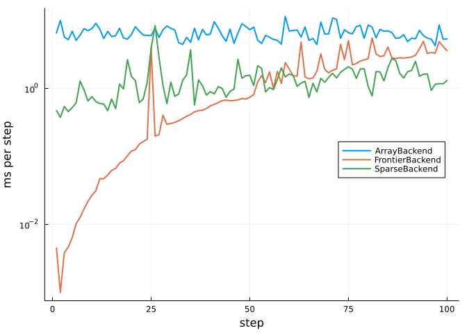

# Writing a backend
Simon Frost

- [Overview](#overview)
- [The interface](#the-interface)
- [The simplest backend](#the-simplest-backend)
- [Visiting only the cells that can
  change](#visiting-only-the-cells-that-can-change)
- [Wrapping a backend](#wrapping-a-backend)
- [Testing a backend](#testing-a-backend)

## Overview

A backend decides where the state of a cellular automaton lives and how
its cells are visited; the model itself, the rule, space, parameters and
update scheme, says nothing about either. The backends that come with
the package (arrays, tiles, GPUs, Agents.jl models, Ark.jl worlds) are
written against a small public interface, and so can a new one, in a
package of its own or in a script. Once written, a backend runs every
problem it accepts through `solve`, `init` and `step!`, with callbacks,
`remake` and ensembles, without further work.

This vignette writes three backends: the simplest one that works, one
that saves work by visiting only the cells that can change, and one that
wraps another backend to time it.

``` julia
ENV["GKSwstype"] = "100"
using CellularAutomataCore
using Plots
using Random
using Statistics
```

## The interface

A backend is a subtype of `AbstractBackend` with methods of eight
functions. `supports`, `read_cell` and `write_cell!` are exported; the
others are public but not exported, as their names are generic, so they
are imported to be extended:

| function | what it does |
|:---|:---|
| `supports(backend, scheme)` | whether the backend runs an update scheme |
| `check_problem(backend, prob, scheme)` | raise an error if it cannot run a problem |
| `allocate_state(backend, prob, scheme)` | create its state, holding `prob.u0` |
| `advance!(backend, state, prob, scheme, p, t)` | one step, from `t` to `t + 1` |
| `current_state(backend, state)` | a copy of the state, in the layout of `u0` |
| `set_state!(backend, state, u)` | replace the state |
| `read_cell(backend, state, I)`, `write_cell!(backend, state, I, v)` | one cell |

Plots.jl also exports a name `AbstractBackend`, for its own plotting
backends, so with both packages loaded the supertype is imported
explicitly too:

``` julia
import CellularAutomataCore: AbstractBackend, supports, check_problem, allocate_state,
                             advance!, current_state, set_state!, read_cell, write_cell!
using CellularAutomataCore: update_cell
```

A backend that runs its own engine needs to apply the rule to one cell.
`update_cell(prob, u, I, t, p)` returns the new state of cell `I` when
the state `u` is updated at time `t`: it reads the neighbours with the
boundary conditions of the space, passes the covariates and parameters,
respects the mask, and draws the same random numbers every other backend
draws.

## The simplest backend

The simplest backend keeps the state in two arrays, computes every
cell’s new state from the first into the second, and swaps them. It runs
the `Synchronous` scheme only.

``` julia
struct LoopBackend <: AbstractBackend end

mutable struct LoopState{U}
    cur::U
    next::U
end

supports(::LoopBackend, ::Synchronous) = true
allocate_state(::LoopBackend, prob, scheme) = LoopState(copy(prob.u0), copy(prob.u0))

function advance!(::LoopBackend, st::LoopState, prob, scheme, p, t)
    for I in cells(prob.space)
        st.next[I] = update_cell(prob, st.cur, I, t, p)
    end
    st.cur, st.next = st.next, st.cur
    return nothing
end

current_state(::LoopBackend, st::LoopState) = copy(st.cur)
set_state!(::LoopBackend, st::LoopState, u) = (copyto!(st.cur, u); nothing)
read_cell(::LoopBackend, st::LoopState, I) = st.cur[I]
write_cell!(::LoopBackend, st::LoopState, I, v) = (st.cur[I] = v; nothing)
```

That is the whole backend. A stochastic epidemic, with susceptible (0),
infected (1) and recovered (2) plants, gives exactly the result of the
default `ArrayBackend`:

``` julia
sir = LocalRule(Moore(1)) do cell, nbrs, ctx
    if cell == 0
        k = count(==(1), nbrs)
        return bernoulli(ctx, 1 - (1 - ctx.p.β)^k, 1) ? Int8(1) : Int8(0)
    elseif cell == 1
        return bernoulli(ctx, ctx.p.γ, 2) ? Int8(2) : Int8(1)
    end
    return cell
end
u0 = zeros(Int8, 60, 60)
u0[30, 30] = 1
prob = CAProblem(sir, u0, 40, (β=0.2, γ=0.1); seed=1)
solve(prob; backend=LoopBackend()).u == solve(prob).u
```

    true

The results agree, and not just in distribution, because a rule’s random
numbers are a function of the seed, the cell, the time and the draw
number (see `uniform`), not of the order in which a backend happens to
visit the cells. Everything else in the package works on the new
backend: here a callback removes the infected plants in a block on day
10, and an ensemble of runs gives each its own seed.

``` julia
function cull!(integ)
    block = view(integ.u, 25:35, 25:35)
    block[block .== 1] .= 2
    return nothing
end
culled = solve(prob; backend=LoopBackend(), callback=PresetTimeCallback([10], cull!))
same = culled.u == solve(prob; callback=PresetTimeCallback([10], cull!)).u
ens = EnsembleProblem(prob; output_func=(sol, ctx) -> (count(>(0), final_state(sol)), false))
runs = solve(ens, Synchronous(), EnsembleThreads(); trajectories=20, backend=LoopBackend(),
             save_everystep=false)
(same_as_array_backend=same, plants_ever_infected=extrema(runs.u))
```

    (same_as_array_backend = true, plants_ever_infected = (1983, 2587))

A scheme the backend does not support is refused when the problem is set
up:

``` julia
try
    solve(prob, Stochastic(0.5); backend=LoopBackend())
catch err
    err
end
```

    UnsupportedCombinationError("Main.Notebook.LoopBackend()", "CellularAutomataCore.Stochastic{Float64}(0.5)")

## Visiting only the cells that can change

In a large field with a small epidemic, almost every cell is susceptible
and surrounded by susceptible cells, and stays so. `LoopBackend` and
`ArrayBackend` update them anyway. A backend can instead keep the list
of *active* cells, those not in a background state, and on each step
update only those and the cells within reach of them: the cells whose
neighbourhood contains an active cell.

Skipping a cell is only correct if the rule leaves a background cell
with an all-background neighbourhood unchanged; such a rule is called
quiescent. An epidemic without infection from outside is; a forest-fire
model with lightning is not. `check_problem` tests a sample of cells and
times with `update_cell`, so that a problem the backend would get wrong
is refused before it runs. The backend runs on a torus, where the cells
within reach wrap around the edges.

``` julia
struct FrontierBackend{T} <: AbstractBackend
    background::T
end

mutable struct FrontierState{U,N}
    u::U                                # the state of record
    active::Vector{CartesianIndex{N}}   # cells not in the background state
    reach::Vector{CartesianIndex{N}}    # offsets from an active cell to the cells it affects
end

supports(::FrontierBackend, ::Synchronous) = true

function check_problem(b::FrontierBackend, prob, scheme)
    space = prob.space
    space isa Lattice && all(x -> x isa Periodic, boundaries(space)) ||
        throw(ArgumentError("FrontierBackend runs on a torus"))
    quiet = fill(b.background, size(space))
    t0 = first(prob.tspan)
    for I in Iterators.take(cells(space), 50), t in t0:(t0 + 3)
        update_cell(prob, quiet, I, t) == b.background ||
            throw(ArgumentError("FrontierBackend needs a quiescent rule: cell $I left the background at t = $t"))
    end
    return nothing
end

function allocate_state(b::FrontierBackend, prob, scheme)
    nbhd = something(neighbourhood(prob.rule), default_neighbourhood(prob.space))
    offsets = collect(neighbourhood_offsets(nbhd, prob.space))
    reach = unique([zero(first(offsets)); -offsets])
    st = FrontierState(copy(prob.u0), CartesianIndex{ndims(prob.u0)}[], reach)
    find_active!(b, st)
    return st
end

function find_active!(b::FrontierBackend, st::FrontierState)
    st.active = [I for I in CartesianIndices(st.u) if st.u[I] != b.background]
    return nothing
end

wrap(I, dims) = CartesianIndex(mod1.(Tuple(I), dims))

function advance!(b::FrontierBackend, st::FrontierState, prob, scheme, p, t)
    dims = size(st.u)
    candidates = Set(wrap(I + r, dims) for I in st.active for r in st.reach)
    # every new state is computed from the old ones before any is written
    new = [(I, update_cell(prob, st.u, I, t, p)) for I in candidates]
    for (I, v) in new
        st.u[I] = v
    end
    st.active = [I for (I, v) in new if v != b.background]
    return nothing
end

current_state(::FrontierBackend, st::FrontierState) = copy(st.u)
function set_state!(b::FrontierBackend, st::FrontierState, u)
    copyto!(st.u, u)
    find_active!(b, st)
    return nothing
end
read_cell(::FrontierBackend, st::FrontierState, I) = st.u[I]
function write_cell!(b::FrontierBackend, st::FrontierState, I, v)
    st.u[I] = v
    v != b.background && push!(st.active, CartesianIndex(I))
    return nothing
end
```

On the same epidemic, the frontier backend agrees with the others:

``` julia
solve(prob; backend=FrontierBackend(Int8(0))).u == solve(prob).u
```

    true

and a rule that is not quiescent is refused:

``` julia
sparks = LocalRule(Moore(1)) do cell, nbrs, ctx
    return cell == 0 && bernoulli(ctx, 0.001) ? Int8(1) : cell
end
try
    solve(CAProblem(sparks, u0, 10); backend=FrontierBackend(Int8(0)))
catch err
    err
end
```

    ArgumentError("FrontierBackend needs a quiescent rule: cell CartesianIndex(2, 1) left the background at t = 1")

The saving grows with the size of the field. Here is the time per step
for an epidemic started from one plant, on fields of 200 × 200 and 1000
× 1000 plants, with `ArrayBackend`, the frontier backend and the
package’s own `SparseBackend`, which stores the active part of the field
in tiles:

``` julia
function ms_per_step(prob, backend)
    solve(prob; backend, save_everystep=false)  # compile
    return 1000 * minimum(@elapsed(solve(prob; backend, save_everystep=false))
                          for _ in 1:3) / prob.tspan[2]
end
timings = map((200, 1000)) do n
    start = zeros(Int8, n, n)
    start[n ÷ 2, n ÷ 2] = 1
    big = CAProblem(sir, start, 60, (β=0.2, γ=0.1); seed=1)
    final = final_state(solve(big; save_everystep=false))
    @assert final == final_state(solve(big; backend=FrontierBackend(Int8(0)),
                                       save_everystep=false))
    (field="$n × $n", infected=count(>(0), final),
     array=round(ms_per_step(big, ArrayBackend()); digits=2),
     frontier=round(ms_per_step(big, FrontierBackend(Int8(0))); digits=2),
     sparse=round(ms_per_step(big, SparseBackend(Int8(0))); digits=2))
end
```

    ((field = "200 × 200", infected = 5583, array = 0.68, frontier = 0.56, sparse = 0.94), (field = "1000 × 1000", infected = 5008, array = 5.69, frontier = 0.46, sparse = 0.85))

On both fields the epidemic reaches about the same few thousand plants,
so the cost of the frontier and sparse backends hardly changes between
them, while that of `ArrayBackend` grows with the area of the field: on
the large one it is about ten times slower. The exact times vary from
run to run.

## Wrapping a backend

A backend can also delegate to another. This one records how long each
step of the backend it wraps takes, and passes every other call through
unchanged.

``` julia
struct TimedBackend{B<:AbstractBackend} <: AbstractBackend
    inner::B
    seconds::Vector{Float64}
end
TimedBackend(inner) = TimedBackend(inner, Float64[])

supports(b::TimedBackend, scheme::AbstractScheme) = supports(b.inner, scheme)
check_problem(b::TimedBackend, prob, scheme) = check_problem(b.inner, prob, scheme)
allocate_state(b::TimedBackend, prob, scheme) = allocate_state(b.inner, prob, scheme)
function advance!(b::TimedBackend, st, prob, scheme, p, t)
    push!(b.seconds, @elapsed advance!(b.inner, st, prob, scheme, p, t))
    return nothing
end
current_state(b::TimedBackend, st) = current_state(b.inner, st)
set_state!(b::TimedBackend, st, u) = set_state!(b.inner, st, u)
read_cell(b::TimedBackend, st, I) = read_cell(b.inner, st, I)
write_cell!(b::TimedBackend, st, I, v) = write_cell!(b.inner, st, I, v)
```

Timing every step on the large field, for longer, shows how the cost of
each backend changes as the epidemic grows:

``` julia
start = zeros(Int8, 1000, 1000)
start[500, 500] = 1
big = CAProblem(sir, start, 100, (β=0.2, γ=0.1); seed=1)
timed = [name => TimedBackend(b)
         for (name, b) in ("ArrayBackend" => ArrayBackend(),
                           "FrontierBackend" => FrontierBackend(Int8(0)),
                           "SparseBackend" => SparseBackend(Int8(0)))]
for (name, b) in timed
    solve(big; backend=b, save_everystep=false)  # compile, then time a fresh run
    empty!(b.seconds)
    solve(big; backend=b, save_everystep=false)
end
plot(; xlabel="step", ylabel="ms per step", yscale=:log10, legend=:right)
for (name, b) in timed
    plot!(1:length(b.seconds), 1000 .* b.seconds; label=name, lw=2)
end
current()
```



`ArrayBackend` costs the same at every step, whatever the epidemic does.
The frontier backend starts almost free, with a single infected plant,
and its cost then grows with every plant the epidemic reaches: recovered
plants are not in the background state, so they stay in its active list.
`SparseBackend` costs more at first, as it updates whole tiles, but it
updates them with the array engine, which is cheaper per cell than a
`Set` and a call to `update_cell`. Once the epidemic has reached a few
thousand plants it is the faster of the two. The isolated spikes are
garbage collection.

## Testing a backend

A backend is correct when it gives exactly the result of the slow,
simple `ReferenceBackend` on every problem it accepts. The package’s own
backends are held to that on a battery of problems covering every space,
boundary condition, neighbourhood, state layout, rule family and update
scheme; a new backend can be checked the same way, skipping the problems
it refuses:

``` julia
problems = [CAProblem(Life(), Int8.(rand(Xoshiro(1), 0:1, 30, 30)), 20),
            CAProblem(Life(), Int8.(rand(Xoshiro(2), 0:1, 20, 24)), 20;
                      space=Grid(20, 24; boundary=Constant(0))),
            CAProblem(Life("B2/S34"), Int8.(rand(Xoshiro(3), 0:1, 14, 16)), 20;
                      space=HexGrid(14, 16)),
            prob]
function runs_and_agrees(backend, prob)
    try
        check_problem(backend, prob, Synchronous())
    catch
        return :refused
    end
    return solve(prob; backend).u == solve(prob; backend=ReferenceBackend()).u
end
[(loop=runs_and_agrees(LoopBackend(), q), frontier=runs_and_agrees(FrontierBackend(Int8(0)), q))
 for q in problems]
```

    4-element Vector{NamedTuple{(:loop, :frontier)}}:
     (loop = true, frontier = true)
     (loop = true, frontier = :refused)
     (loop = true, frontier = true)
     (loop = true, frontier = true)

The frontier backend refuses Life on a bounded grid, which is not a
torus, and agrees wherever it runs, including the hexagonal torus: there
too a neighbourhood is a list of offsets, which wrap around the edges in
the same way. The loop backend runs and agrees everywhere, because
`update_cell` handles every space and boundary condition.
