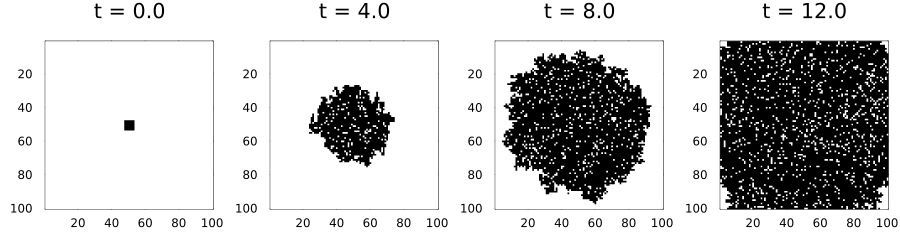
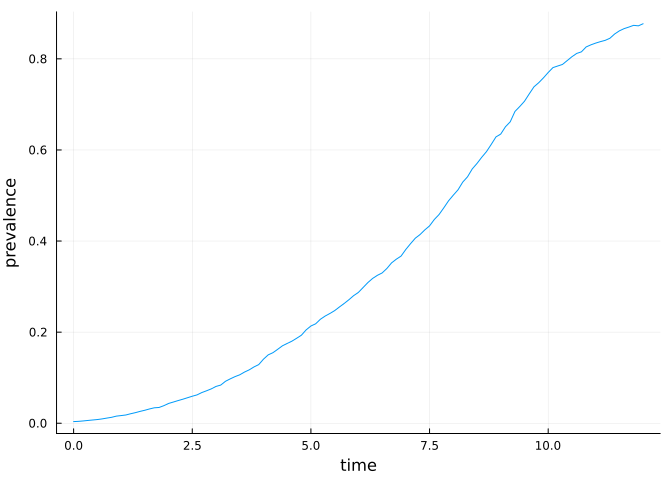
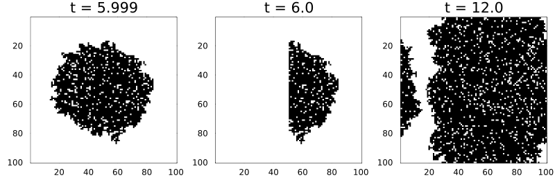
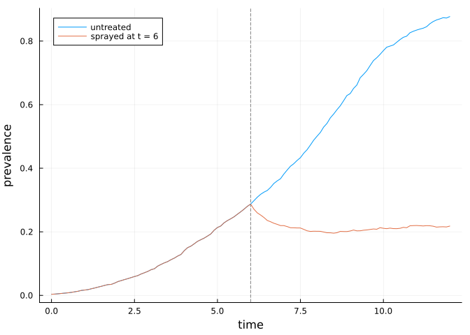
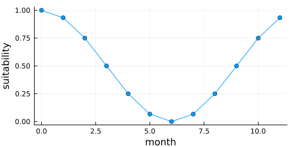
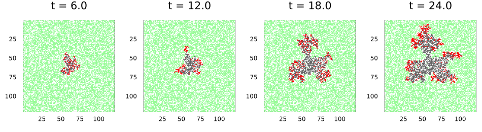
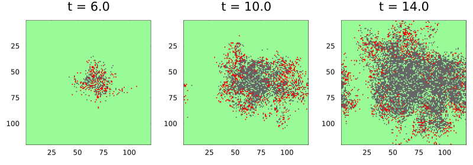
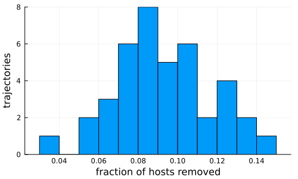
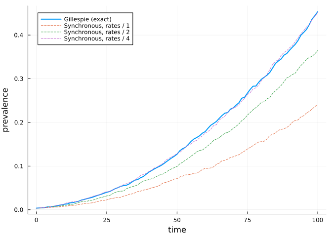

# Event-driven dynamics
Simon Frost

- [Overview](#overview)
- [Rules as rates](#rules-as-rates)
- [One event at a time](#one-event-at-a-time)
- [Summaries over time](#summaries-over-time)
- [Three methods](#three-methods)
- [Interventions at exact times](#interventions-at-exact-times)
- [A sparse, seasonal landscape](#a-sparse-seasonal-landscape)
- [Dispersal through a kernel](#dispersal-through-a-kernel)
- [Large, mostly empty landscapes](#large-mostly-empty-landscapes)
- [Ensembles](#ensembles)
- [The same rule in discrete time](#the-same-rule-in-discrete-time)

## Overview

Many plant-disease and pest models are written as rates, not as per-step
probabilities: a susceptible plant becomes infected at rate β times its
number of infected neighbours, and an infected plant is removed at rate
γ. Such a model is a continuous-time Markov chain on the lattice. This
vignette shows how to write one as an `EventRule`, simulate it exactly,
event by event, with the `Gillespie` scheme, act on it at exact times,
and run the same rule in discrete time.

``` julia
ENV["GKSwstype"] = "100"
using CellularAutomataCore
using Plots
using Random
using Statistics
```

## Rules as rates

An `EventRule`’s function returns the cell’s possible transitions as
`rate => new_state` pairs. Here is the contact process (an SIS
epidemic): susceptible cells (0) are infected by each infected neighbour
at rate β, and infected cells (1) recover at rate γ.

``` julia
sis = EventRule(VonNeumann(1)) do cell, nbrs, ctx
    if cell == 0
        (ctx.p.β * count(==(1), nbrs) => 1,)
    else
        (ctx.p.γ => 0,)
    end
end
```

    EventRule(<anonymous function>, VonNeumann(1))

A problem with an event rule takes real times. `Gillespie()` simulates
it exactly, and `saveat` takes real saving times.

``` julia
n = 100
u0 = zeros(Int8, n, n)
u0[48:53, 48:53] .= 1
prob = CAProblem(sis, u0, 12.0, (β=2.5, γ=1.0); seed=1)
sol = solve(prob, Gillespie(); saveat=4.0)
sol.t
```

    4-element Vector{Float64}:
      0.0
      4.0
      8.0
     12.0

``` julia
plot([plot(sol; snapshot=i, c=:binary, colorbar=false, title="t = $(sol.t[i])")
      for i in eachindex(sol.t)]...; layout=(1, 4), size=(900, 250))
```



The contact process on the square lattice persists only when β/γ exceeds
about 1.65. At 2.5 the infection spreads outwards as a ragged front, and
recoveries leave holes behind it that are soon reinfected.

## One event at a time

A step of a continuous-time integrator is one event: the time jumps to
the next event and exactly one cell changes.

``` julia
integ = init(prob, Gillespie())
before = copy(integ.u)
step!(integ)
integ.t, findall(integ.u .!= before)
```

    (0.006665324843065025, CartesianIndex{2}[CartesianIndex(54, 51)])

## Summaries over time

Saving whole lattices is expensive. A `SavingCallback` records a summary
at real times instead; here the prevalence every 0.1 time units.

``` julia
prevalence = SavedValues(Float64, Float64)
solve(prob, Gillespie(); callback=SavingCallback((u, t, integ) -> mean(u), prevalence;
                                                 saveat=0.1))
plot(prevalence.t, prevalence.saveval; xlabel="time", ylabel="prevalence", legend=false)
```



## Three methods

`Gillespie(:next_reaction)`, the default, gives every cell its own
exponential clock in a heap. After an event it recomputes only the cell
and its neighbours, so an event costs the same however large the lattice
is. `Gillespie(:direct)` sums every rate at every event; it is simple
and serves as a reference. `Gillespie(:composition_rejection)` ([Slepoy
et al. 2008](#ref-Slepoy2008)) is the direct method made fast: cells are
grouped by the binary order of magnitude of their rates, an event picks
a group by its total rate and then a cell in it by rejection, so it too
costs the same however large the lattice is. The three sample the same
process but use their random numbers differently, so they agree in
distribution, not path by path.

``` julia
function final_prevalences(method; reps=40)
    [mean(final_state(solve(remake(prob; tspan=3.0, seed=s), Gillespie(method))))
     for s in 1:reps]
end
[(; method, mean=mean(v), sd=std(v))
 for (method, v) in ((m, final_prevalences(m))
                     for m in (:next_reaction, :direct, :composition_rejection))]
```

    3-element Vector{@NamedTuple{method::Symbol, mean::Float64, sd::Float64}}:
     (method = :next_reaction, mean = 0.0823575, sd = 0.008374898009329229)
     (method = :direct, mean = 0.08184750000000002, sd = 0.00795738610284455)
     (method = :composition_rejection, mean = 0.08067499999999998, sd = 0.00755885454624456)

``` julia
small = remake(prob; tspan=3.0)
times = map((:next_reaction, :direct, :composition_rejection)) do m
    solve(small, Gillespie(m))
    return m => @elapsed solve(small, Gillespie(m))
end
```

    (:next_reaction => 0.002112667, :direct => 0.038457667, :composition_rejection => 0.001979584)

The random numbers are counter-based, as everywhere in the package: a
cell’s `n`-th waiting time is a function of the seed, the cell and `n`
alone. A run is reproducible and does not depend on the order in which
events are processed.

## Interventions at exact times

Callbacks work as in discrete time. `PresetTimeCallback` and
`PeriodicCallback` also make the simulation stop at exactly their times,
even when no event falls there. Here every infected cell in the left
half of the lattice is cleared (roguing) at t = 6.

``` julia
rogue! = integ -> (integ.u[:, 1:(n ÷ 2)] .= 0)
s = solve(prob, Gillespie(); saveat=[5.999, 6.0, 12.0],
          callback=PresetTimeCallback([6.0], rogue!))
plot([plot(s; snapshot=i, c=:binary, colorbar=false, title="t = $(s.t[i])")
      for i in 2:4]...; layout=(1, 3), size=(800, 260))
```



Changing the parameters from a callback (`integ.p = ...`) changes every
rate from that moment on. Here transmission falls to a quarter at t = 6,
as if a protectant were sprayed. The prevalence drops at once and then
holds roughly steady. β/γ = 0.625 is below the lattice threshold, so the
infection will die out, but slowly: each cell still has four neighbours
to infect, and dense infected patches persist for a long time before
fluctuations clear them.

``` julia
spray = PresetTimeCallback([6.0], integ -> (integ.p = (β=integ.p.β / 4, γ=integ.p.γ)))
sprayed = SavedValues(Float64, Float64)
solve(prob, Gillespie();
      callback=CallbackSet(spray, SavingCallback((u, t, i) -> mean(u), sprayed; saveat=0.1)))
plot(prevalence.t, prevalence.saveval; label="untreated", xlabel="time",
     ylabel="prevalence")
plot!(sprayed.t, sprayed.saveval; label="sprayed at t = 6")
vline!([6.0]; label=nothing, ls=:dash, c=:grey)
```



## A sparse, seasonal landscape

Real host landscapes are patchy and the weather is seasonal. This model
is an SIR epidemic among plants that occupy 60% of the cells, written
with `@camodel` and an `@events` block. Cells without a host are masked,
so they never change. Infection is driven by a seasonal suitability
covariate with one slice per unit of time. In continuous time the rule
sees `ctx.t`, the integer part of the time, and the rates are recomputed
at every whole time.

``` julia
sir = @camodel PlantSIR begin
    @description "Plant SIR epidemic with seasonal transmission"
    @states state::Int8 = 0 ∈ (0, 1, 2, 3)   # 0 no host, 1 S, 2 I, 3 R
    @parameters β = 1.2 γ = 0.25
    @neighbourhood Moore(1)
    @covariates season
    @events begin
        if cell == 1
            (β * covariate(ctx, :season) * count(==(2), nbrs) => Int8(2),)
        elseif cell == 2
            (γ => Int8(3),)
        else
            ()
        end
    end
end
```

    CAModel PlantSIR
      Plant SIR epidemic with seasonal transmission
      states:
        state::Int8 = 0 ∈ (0, 1, 2, 3)
      parameters:
        β = 1.2
        γ = 0.25
      covariates: season
      rule: EventRule(<anonymous function>, Moore(1))

``` julia
m = 120
hosts = rand(Xoshiro(3), m, m) .< 0.6
start = Int8.(hosts)               # every host susceptible ...
for I in CartesianIndices((58:62, 58:62))
    hosts[I] && (start[I] = 2)     # ... except a small infected patch
end
season = cat([fill(0.5 + 0.5 * cospi(2t / 12), m, m) for t in 0:11]...; dims=3)
plot(0:11, season[1, 1, :]; xlabel="month", ylabel="suitability", legend=false,
     size=(500, 250), marker=:circle)
```



``` julia
p = CAProblem(sir, (state=start,), 24.0; space=Torus(m, m), mask=hosts,
              covariates=(season=season,), seed=4)
ssol = solve(p, Gillespie(); saveat=6.0)
plot([plot(Torus(m, m), u; c=[:white, :palegreen, :red, :grey40], clims=(0, 3),
           colorbar=false, title="t = $t") for (t, u) in zip(ssol.t[2:end], ssol.u[2:end])]...;
     layout=(1, 4), size=(950, 260))
```



## Dispersal through a kernel

Spores and insects travel farther than the next cell. A rule reads such
long-range pressure from a `KernelField`, a weighted sum of a cell-level
quantity over a dispersal kernel. In continuous time the field is kept
up to date event by event: when a cell changes, every cell that reads it
within the kernel gains its weighted change, and their rates are
recomputed. An event then costs time in proportion to the kernel’s size,
not the lattice’s.

``` julia
spores = EventRule() do c, nbrs, ctx
    c == 0 ? (ctx.p.β * field(ctx, :pressure) => 1,) : c == 1 ? (ctx.p.γ => 2,) : ()
end
pressure = KernelField(ExponentialKernel(2.0), c -> Float64(c == 1); include_centre=false)
v0 = zeros(Int8, 120, 120)
v0[60, 60] = 1
kp = CAProblem(spores, v0, 14.0, (β=2.0, γ=1.0); space=Torus(120, 120), seed=2,
               fields=(; pressure))
ksol = solve(kp, Gillespie(); saveat=[6.0, 10.0, 14.0])
plot([plot(Torus(120, 120), u; c=[:palegreen, :red, :grey40], clims=(0, 2),
           colorbar=false, title="t = $t") for (t, u) in zip(ksol.t[2:end], ksol.u[2:end])]...;
     layout=(1, 3), size=(800, 280))
```



With exponential dispersal of mean distance two cells, the epidemic
grows as a ragged front with satellite foci ahead of it, which a
nearest-neighbour rule cannot produce.

## Large, mostly empty landscapes

An invasion that starts from a few cells touches little of a large
lattice for a long time. `SparseBackend` keeps only the parts of the
lattice that differ from a background state; with `Gillespie` it gives
clocks only to the cells that differ and to the cells near them, which
are the only ones that can have a positive rate (the rule must give a
background cell among background neighbours rate zero). The run equals
the `ArrayBackend` run event for event, at a fraction of the memory:

``` julia
big = zeros(Int8, 2000, 2000)
big[1000:1002, 1000:1002] .= 1
bp = CAProblem(sis, big, 8.0, (β=0.6, γ=1.0); space=Torus(2000, 2000), seed=1)
sparse = solve(bp, Gillespie(); backend=SparseBackend(Int8(0)), save_everystep=false)
dense = solve(bp, Gillespie(); save_everystep=false)
memory(b) = Base.summarysize(init(bp, Gillespie(); backend=b, save_everystep=false).state)
(same=final_state(sparse) == final_state(dense), infected=sum(final_state(sparse)),
 sparse_MB=memory(SparseBackend(Int8(0))) / 1e6, dense_MB=memory(ArrayBackend()) / 1e6)
```

    (same = true, infected = 59, sparse_MB = 0.066304, dense_MB = 484.000648)

## Ensembles

An `EnsembleProblem` gives every trajectory its own seed, as in discrete
time. Here is the distribution of the final epidemic size in the
seasonal landscape.

``` julia
ens = solve(EnsembleProblem(p; output_func=(s, ctx) -> (count(==(3), final_state(s)), false)),
            Gillespie(), EnsembleThreads(); trajectories=40, save_everystep=false)
histogram(ens.u ./ count(hosts); bins=15, xlabel="fraction of hosts removed",
          ylabel="trajectories", legend=false, size=(500, 300))
```



## The same rule in discrete time

An event rule also runs under the synchronous schemes. In each step a
cell with total rate `a` changes with probability `1 - exp(-a)`, and if
it changes, it picks a transition in proportion to the rates. This is
the usual chain-binomial discretisation, and it runs on every backend,
GPUs included. It is an approximation: a cell infected during a step
cannot pass the infection on until the next one, so the discrete-time
epidemic lags the exact one. The lag shrinks as the step shrinks
relative to the rates. Below, the rates are divided by `k` and the run
lengthened `k` times, which leaves the exact process unchanged up to a
rescaling of time but makes each step a smaller slice of it.

``` julia
function prevalence_curve(k; exact)
    q = remake(prob; p=(β=0.2 / k, γ=0.1 / k), tspan=exact ? 100.0k : 100k)
    saved = SavedValues(exact ? Float64 : Int, Float64)
    cb = SavingCallback((u, t, i) -> mean(u), saved; saveat=k)
    exact ? solve(q, Gillespie(); callback=cb) : solve(q; callback=cb, save_everystep=false)
    return saved.t ./ k, saved.saveval
end
plot(prevalence_curve(1; exact=true)...; label="Gillespie (exact)", lw=2,
     xlabel="time", ylabel="prevalence", legend=:topleft)
for k in (1, 2, 4)
    plot!(prevalence_curve(k; exact=false)...; label="Synchronous, rates / $k", ls=:dash)
end
plot!()
```



<div id="refs" class="references csl-bib-body hanging-indent">

<div id="ref-Slepoy2008" class="csl-entry">

Slepoy, Alexander, Aidan P. Thompson, and Steven J. Plimpton. 2008. “A
Constant-Time Kinetic Monte Carlo Algorithm for Simulation of Large
Biochemical Reaction Networks.” *The Journal of Chemical Physics* 128
(20): 205101. <https://doi.org/10.1063/1.2919546>.

</div>

</div>
